# UI UC-01 · Đăng nhập Google và quản lý phiên

**UI v2 · Chờ duyệt** · 2026-11-22 · [UC spec](uc-01-google-sign-in-and-session.md)

Ảnh PNG minh họa được dựng bằng HTML/CSS và xuất cục bộ ở khung 390 × 760 bằng Chromium. Dữ liệu và thông tin hệ thống là mẫu. [Bản dựng cục bộ](ui/essential-preview.html) có từng trạng thái để đối chiếu. Bộ này phục vụ duyệt thiết kế và luồng. Nghiệm thu hiển thị native và hành vi trên thiết bị thuộc các SCN của UC.

- [Mockup và bảng SCR ở SRS trang 2](../requirements/lost-and-found-srs.pdf#page=2) làm căn cứ cho vùng thương hiệu, trạng thái chờ, điều khoản và đăng nhập lại. [SRS trang 3](../requirements/lost-and-found-srs.pdf#page=3) làm căn cứ cho hộp thoại đăng xuất. Câu chữ ERR-A1–A4 theo [SRS trang 10](../requirements/lost-and-found-srs.pdf#page=10).
- Thứ tự điều khoản sau Google và trước Core, cờ theo bản cài, xử lý khôi phục và thu hồi theo [GAP-AUTH-001–004](../requirements/analysis/uc-01-02.md#uc-01--đăng-nhập-và-quản-lý-phiên) và [bundle UC-01 đã duyệt](../operations/runs/uc-01-essential.json#L129). Phiên bản nguồn được ghim tại [UC spec](uc-01-google-sign-in-and-session.md#nguồn).
- Bố cục và thông báo được đối chiếu với [App.tsx](../../apps/mobile/App.tsx), [auth-flow.ts](../../apps/mobile/src/auth-flow.ts) và [auth-platform.tsx](../../apps/mobile/src/auth-platform.tsx). Hình điều khoản dùng hai liên kết như app hiện tại, còn mockup SRS có thêm khối tài khoản Google và phần nội dung hai chính sách. Nội dung, URL và cách trình bày chính sách thật nằm trong [điểm cần duyệt](#điểm-cần-duyệt).

Xem nhanh [Đăng nhập](#scr-01-ready), [Điều khoản](#scr-01-consent), [lỗi đăng nhập](#scr-01-err-a1), [khôi phục phiên](#scr-01-restoring), [Đăng nhập lại](#scr-01-session-expired), [Xác nhận đăng xuất](#scr-04-confirm) và [điểm cần duyệt](#điểm-cần-duyệt).

## Đăng nhập và cấp phiên

### SCR-01 · Đăng nhập

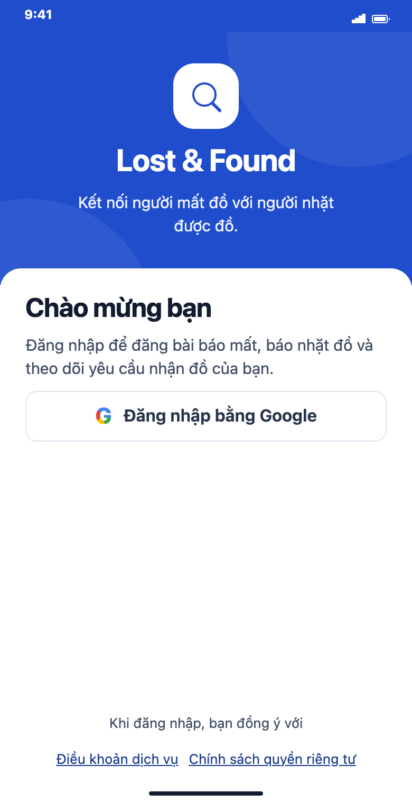

Có nút **Đăng nhập bằng Google** và hai liên kết chính sách. Hình nút minh họa vị trí và trạng thái thao tác. Bản native dùng nút của SDK. Đối chiếu [luồng chính](uc-01-google-sign-in-and-session.md#giao-dien-main), [luồng thay thế](uc-01-google-sign-in-and-session.md#giao-dien-alt), [luồng ngoại lệ](uc-01-google-sign-in-and-session.md#giao-dien-error) và SCN-AUTH-01–03/17/19 và SCN-PRF-15.

### SCR-01 · Đang mở trình chọn Google

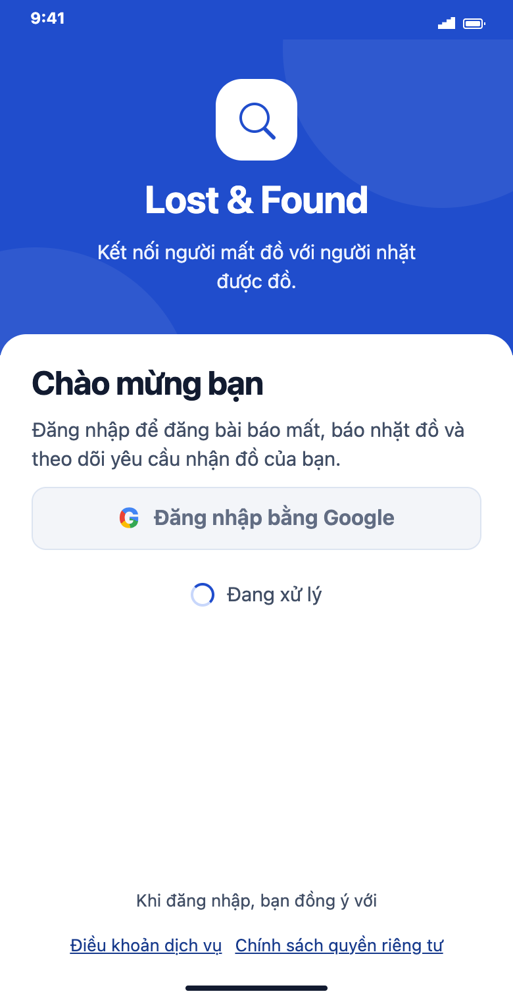

App khóa nút Google trong lúc chuyển giao. Google SDK sở hữu trình chọn từ thao tác bấm nút đến khi trả tài khoản hoặc kết quả hủy. Hủy trở lại Đăng nhập, còn có token thì sang điều khoản hoặc chờ Core. Đối chiếu [luồng chính](uc-01-google-sign-in-and-session.md#giao-dien-main), [luồng thay thế](uc-01-google-sign-in-and-session.md#giao-dien-alt) và SCN-AUTH-02/03/06/19.

### SCR-01 · Xác nhận điều khoản và quyền riêng tư

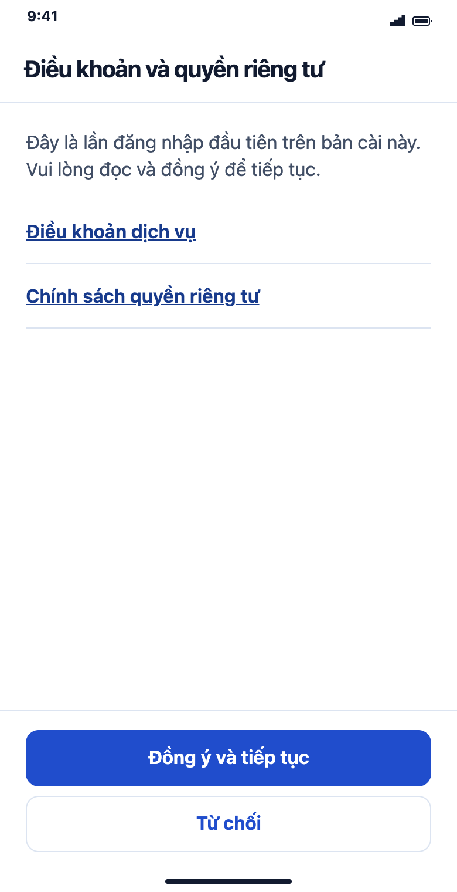

Trạng thái trong luồng SCR-01, chưa có mã SCR riêng. Hai liên kết để đọc chính sách. **Đồng ý và tiếp tục** chuyển sang cấp phiên. **Từ chối** trở về Đăng nhập. Cờ bản cài được ghi sau khi cấp và lưu phiên thành công. Đối chiếu [luồng chính](uc-01-google-sign-in-and-session.md#giao-dien-main), [luồng thay thế](uc-01-google-sign-in-and-session.md#giao-dien-alt) và SCN-AUTH-03/21.

### SCR-01 · Đang xác thực với Core

Nút Google tạm khóa và có chỉ báo chờ. **Chọn tài khoản khác** bỏ lượt đang chờ trước lúc ghi kho phiên, rồi mở lại luồng từ Đăng nhập. Kết quả lượt cũ bị bỏ. Đối chiếu [luồng chính](uc-01-google-sign-in-and-session.md#giao-dien-main), [luồng thay thế](uc-01-google-sign-in-and-session.md#giao-dien-alt), [luồng ngoại lệ](uc-01-google-sign-in-and-session.md#giao-dien-error) và SCN-AUTH-04/07/09/10/21.

### Trang chính · Chưa gán SCR · Vào ứng dụng

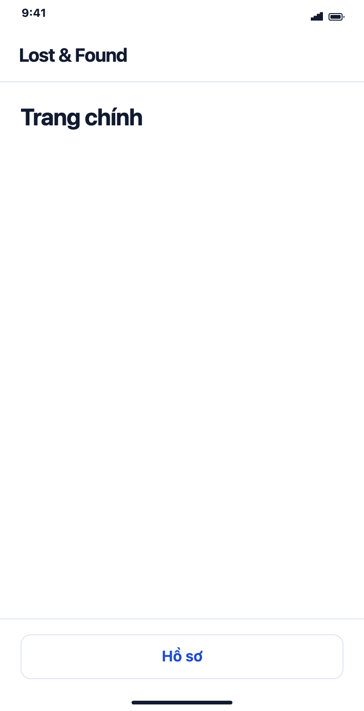

**Hồ sơ** mở SCR-02. Bố cục minh họa lối vào Essential. App hiện tại có thêm nút **Đăng xuất** ở Trang chính. Phương án trình duyệt dùng lối đăng xuất qua Hồ sơ, theo điểm kích hoạt SCR-04 của SCN-AUTH-15. Đối chiếu [luồng chính](uc-01-google-sign-in-and-session.md#giao-dien-main) và SCN-AUTH-04/11 và SCN-PRF-03/16.

## Lỗi đăng nhập và liên kết

### SCR-01 · ERR-A1 · Mất kết nối

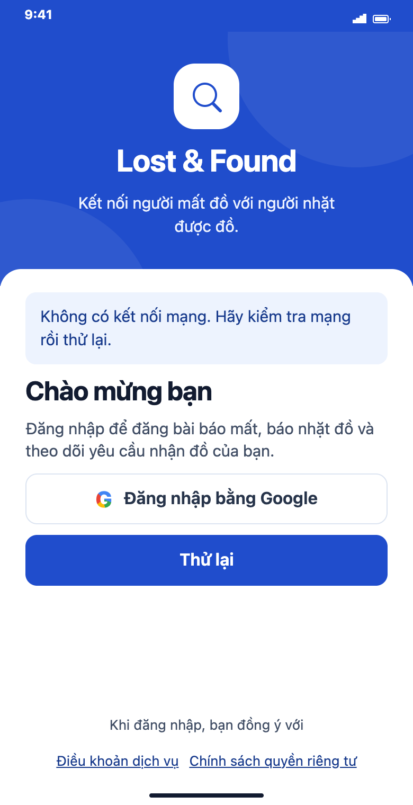

**Thử lại** mở lại Google khi lỗi xảy ra trước khi có token. Nếu đã có lượt cấp phiên, thử lại lượt đó khi còn hợp lệ. Đối chiếu [luồng ngoại lệ](uc-01-google-sign-in-and-session.md#giao-dien-error) và SCN-AUTH-06/07/09.

### SCR-01 · ERR-A2 · Google tạm lỗi

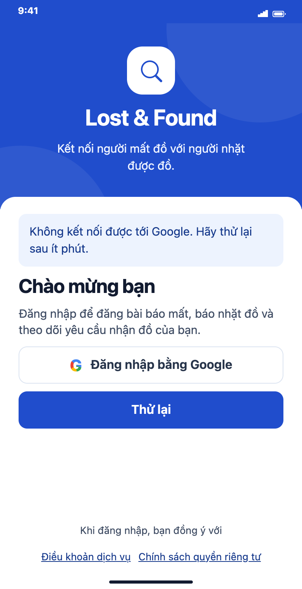

**Thử lại** mở Google. Core chưa nhận yêu cầu cấp phiên. Đối chiếu [luồng ngoại lệ](uc-01-google-sign-in-and-session.md#giao-dien-error) và SCN-AUTH-06.

### SCR-01 · ERR-A3 · Core tạm lỗi hoặc timeout

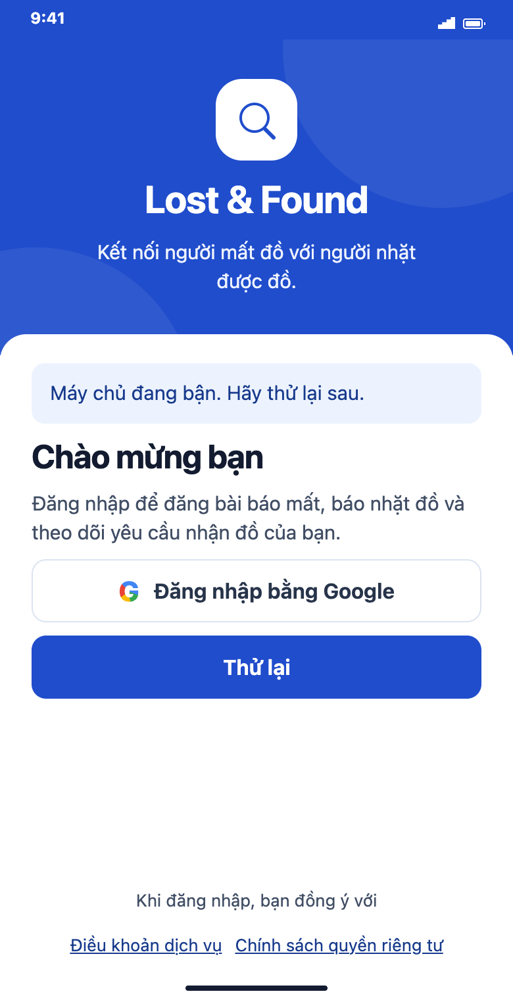

**Thử lại** gửi lại lượt cấp còn hợp lệ. Mở Google từ nút đăng nhập để bắt đầu lượt mới. Đối chiếu [luồng ngoại lệ](uc-01-google-sign-in-and-session.md#giao-dien-error) và SCN-AUTH-07/09.

### SCR-01 · ERR-A4 · Cần chọn lại tài khoản

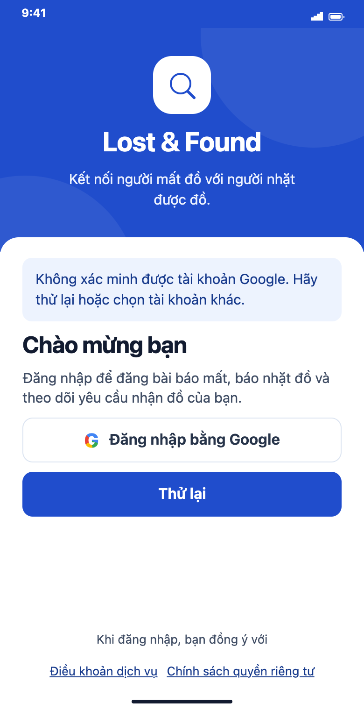

**Thử lại** trở lại trình chọn và tạo lượt mới nếu người dùng chọn tài khoản. App hiện dùng cùng thông báo cho token bị từ chối và các lỗi cấp cần chọn lại. Đối chiếu [luồng ngoại lệ](uc-01-google-sign-in-and-session.md#giao-dien-error) và SCN-AUTH-08/10.

### SCR-01 · Cảnh báo liên kết chưa sẵn sàng

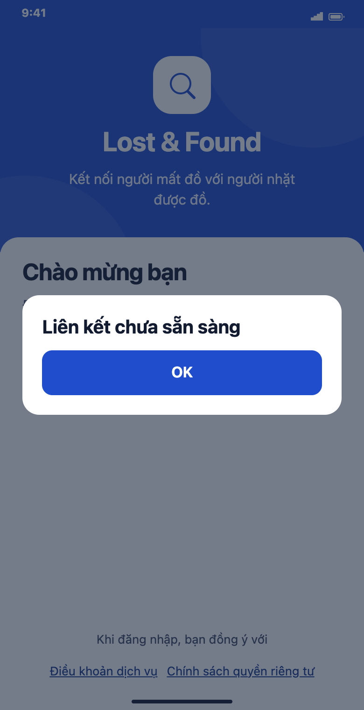

Minh họa trên Đăng nhập. Cảnh báo tương tự áp dụng khi bấm một trong hai liên kết ở màn điều khoản nếu URL môi trường chưa sẵn sàng. **OK** đóng cảnh báo. Đối chiếu [luồng thay thế](uc-01-google-sign-in-and-session.md#giao-dien-alt), [luồng ngoại lệ](uc-01-google-sign-in-and-session.md#giao-dien-error) và SCN-AUTH-01/03/19.

### SCR-01 · Cảnh báo không mở được liên kết

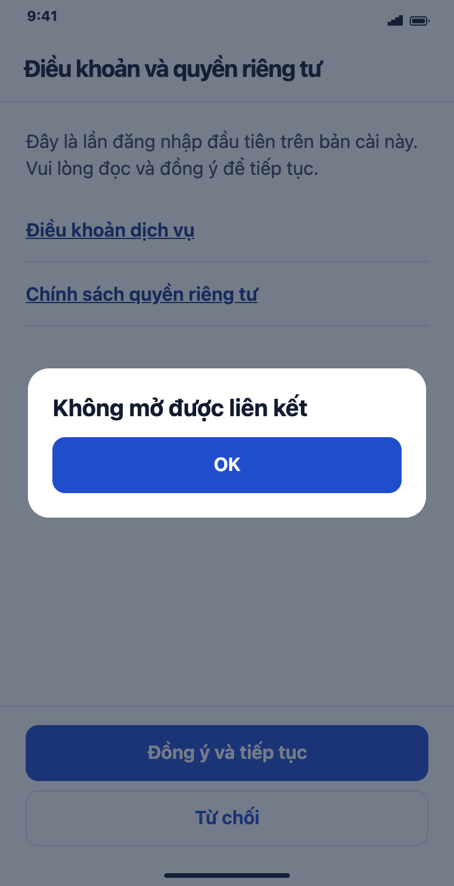

Minh họa trên màn điều khoản. Cảnh báo tương tự áp dụng ở Đăng nhập nếu hệ điều hành báo không mở được URL. **OK** trở lại màn nguồn. Đối chiếu [luồng thay thế](uc-01-google-sign-in-and-session.md#giao-dien-alt), [luồng ngoại lệ](uc-01-google-sign-in-and-session.md#giao-dien-error) và SCN-AUTH-01/03/19.

## Khôi phục và dọn phiên

### SCR-01 · Đang xác minh phiên đã lưu

Trạng thái mở nguội trong lúc đọc kho và xác minh. Vùng cá nhân ẩn trước kết quả xác minh. Đối chiếu [luồng chính](uc-01-google-sign-in-and-session.md#giao-dien-main), [luồng ngoại lệ](uc-01-google-sign-in-and-session.md#giao-dien-error) và SCN-AUTH-11/12/21.

### SCR-01 · Khôi phục phiên · Mất mạng

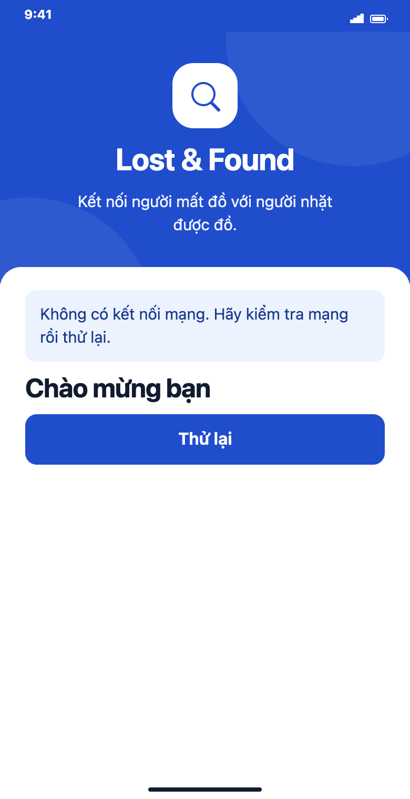

Giữ mã phiên đã lưu và ẩn vùng cá nhân. **Thử lại** xác minh phiên đã lưu. Đối chiếu [luồng ngoại lệ](uc-01-google-sign-in-and-session.md#giao-dien-error) và SCN-AUTH-12.

### SCR-01 · Khôi phục phiên · Core tạm lỗi

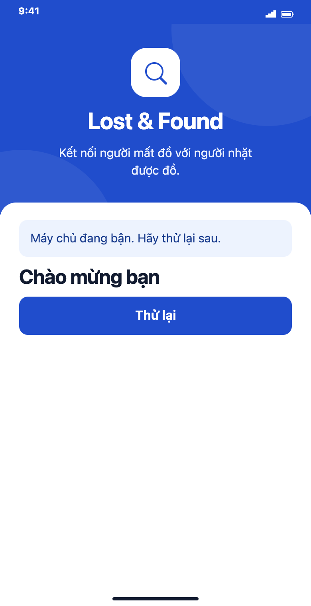

Giữ mã phiên đã lưu khi Core tạm lỗi hoặc timeout. **Thử lại** xác minh phiên đã lưu. Đối chiếu [luồng ngoại lệ](uc-01-google-sign-in-and-session.md#giao-dien-error) và SCN-AUTH-12.

### SCR-01 · Yêu cầu đăng nhập lại

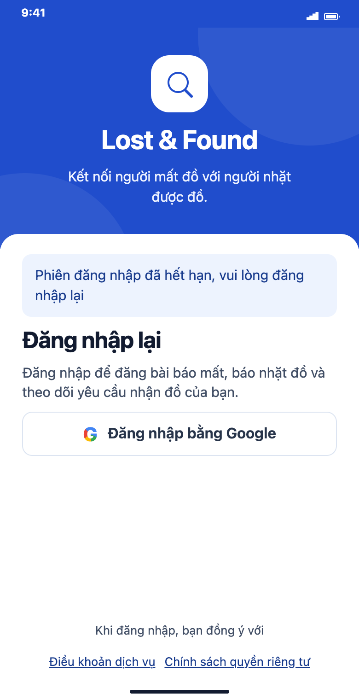

Màn đã dọn hiển thị thông báo hết phiên và lối đăng nhập Google. Mốc FR-AUTH-10 tính từ lúc phát hiện mất phiên. Đối chiếu [luồng ngoại lệ](uc-01-google-sign-in-and-session.md#giao-dien-error) và SCN-AUTH-13/21 và SCN-PRF-12/15.

### SCR-04 · Xác nhận đăng xuất

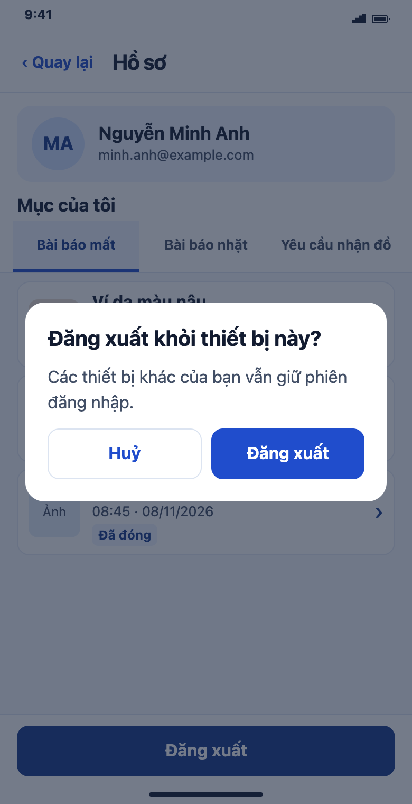

Hộp thoại phủ SCR-02 với phần Mục của tôi theo [bố cục UC-02 v2](uc-02-profile-and-my-items-ui.md#scr-02-ready). **Huỷ** đóng hộp thoại và giữ tab hiện hành. **Đăng xuất** dọn thiết bị này. Dòng mô tả về thiết bị khác lấy từ mockup và phù hợp GAP-AUTH-004. Đối chiếu [luồng chính](uc-01-google-sign-in-and-session.md#giao-dien-main), [luồng thay thế](uc-01-google-sign-in-and-session.md#giao-dien-alt) và SCN-AUTH-15–17 và SCN-PRF-15.

### SCR-01 · Đang dọn phiên

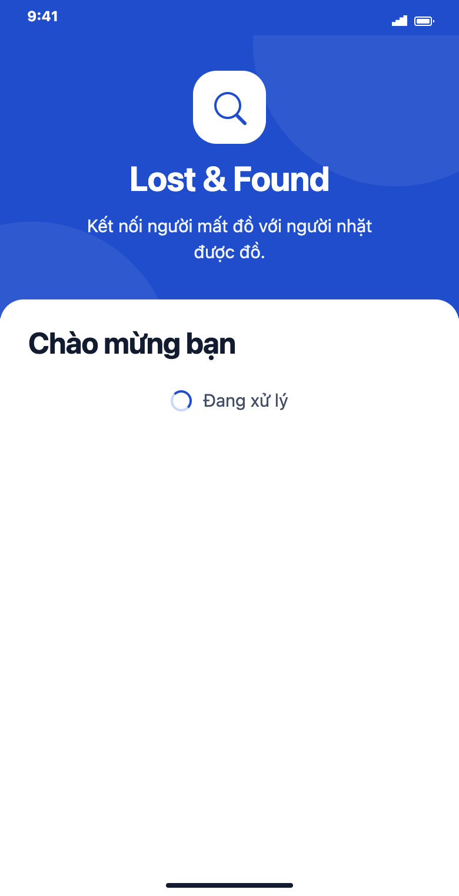

Chỉ báo chờ trong lúc dọn. Vùng cá nhân đã ẩn và Quay lại bị chặn ở trạng thái chờ này. Đối chiếu [luồng chính](uc-01-google-sign-in-and-session.md#giao-dien-main), [luồng ngoại lệ](uc-01-google-sign-in-and-session.md#giao-dien-error) và SCN-AUTH-13/16/17/21 và SCN-PRF-15.

### SCR-01 · Đăng xuất cục bộ, chờ xác nhận thu hồi

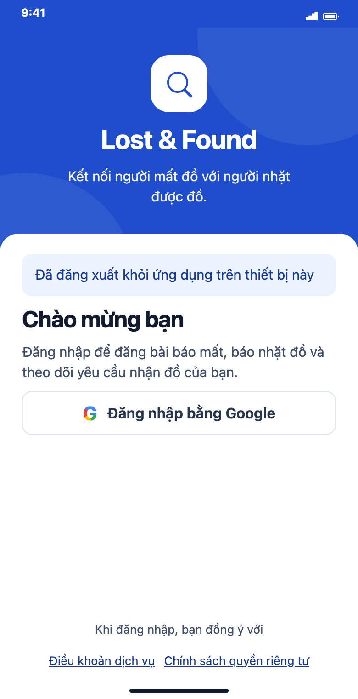

Thông báo xác nhận việc đăng xuất trên thiết bị này. Nếu nhận được xác nhận thu hồi trước khi sang lượt mới, Mobile trở về hình Đăng nhập sạch. Đối chiếu [luồng ngoại lệ](uc-01-google-sign-in-and-session.md#giao-dien-error) và SCN-AUTH-17 và SCN-PRF-15.

### SCR-01 · Kho phiên chưa dọn được

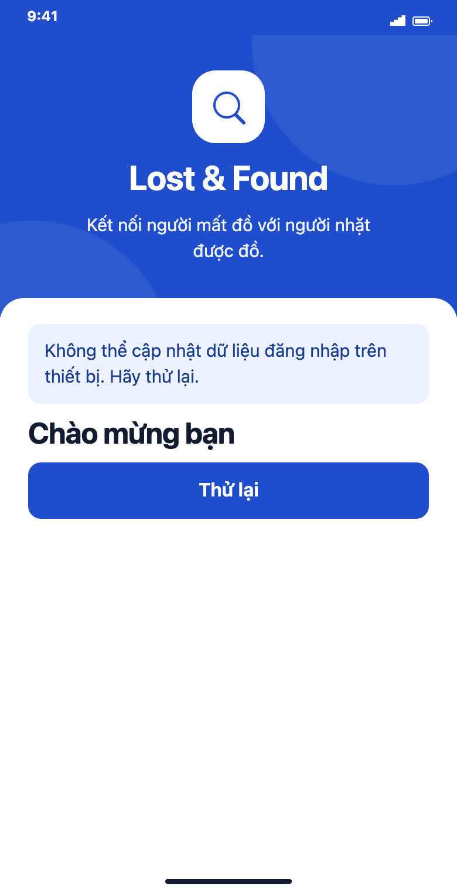

Phương án theo app hiện tại. Vùng cá nhân ẩn và **Thử lại** tiếp tục dọn kho phiên. Sau khi dọn được, kết quả phụ thuộc luồng đã kích hoạt. Đối chiếu [luồng ngoại lệ](uc-01-google-sign-in-and-session.md#giao-dien-error) và SCN-AUTH-04/13/16/17.

### SCR-01 · Lưu phiên thất bại, đã dọn cục bộ

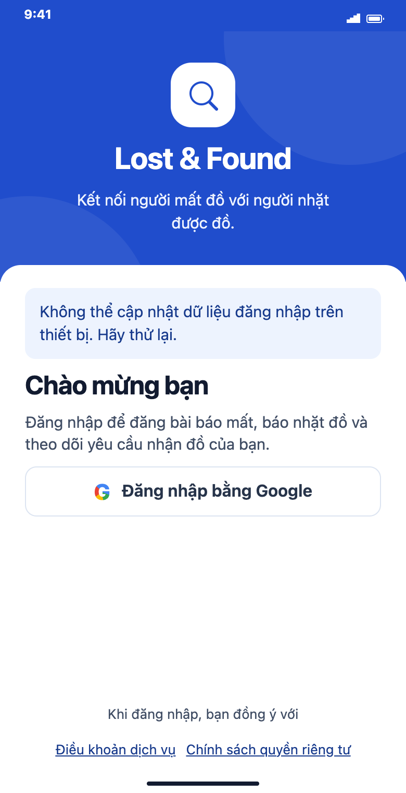

Phương án theo app hiện tại. Khi dọn được sau lỗi lưu, khách về Đăng nhập với thông báo và có thể mở Google lại. Đối chiếu [luồng ngoại lệ](uc-01-google-sign-in-and-session.md#giao-dien-error) và SCN-AUTH-04.

## Điểm cần duyệt

- **Điều khoản.** Sản phẩm chốt URL HTTPS thật, hành vi khi nội dung đổi, nhu cầu lưu bằng chứng và có cần đưa khối tài khoản hoặc nội dung chính sách vào màn xác nhận như mockup. Ảnh hiện theo bố cục hai liên kết của app. Ảnh hưởng bước Đăng nhập 1/3, nhánh mở liên kết và SCN-AUTH-01/03/19/21. PR-02 còn chờ cách tính thời gian đọc và đồng ý.
- **Lối đăng xuất và lỗi kho phiên.** Xác nhận bố cục Essential chỉ dẫn đăng xuất qua Hồ sơ, hoặc giữ thêm lối đang có trên Trang chính. Xác nhận dùng cách xử lý lỗi ghi/dọn kho ở app hiện tại làm yêu cầu nghiệm thu. Ảnh hưởng bước Đăng nhập 5, bước Đăng xuất 1–3 và SCN-AUTH-04/13/15–17.
- Các quyết định về dữ liệu Google thật, thiết bị, thời hạn phiên sản phẩm, hạn mức và điều kiện đo nằm ở [phần còn mở của UC spec](uc-01-google-sign-in-and-session.md#khác-biệt-giữa-nguồn-và-tiêu-chí-còn-mở).
