# UC-01 · Màn hình và trạng thái

**UI 0.5 · Triển khai UC-01**

Phong cách thị giác của UC-01 dựa trên ảnh thiết kế cũ của nhóm gửi trong hội thoại. Áp dụng nền nhận diện xanh dương `#1E4BDD`, họa tiết tròn, biểu tượng kính lúp, thẻ nội dung trắng bo góc và hộp thông báo xanh nhạt. Dùng Inter với Roboto hoặc Segoe UI dự phòng vì ảnh tham chiếu không cung cấp tên phông gốc. Tiêu đề thương hiệu 26, tiêu đề màn 23, nội dung 15 và nhãn nút 16 trên khung minh họa 390 × 760. Tiếp tục áp dụng các nguyên tắc về biểu mẫu, trạng thái và vùng chạm trong [UI guidelines 0.2 · Chờ duyệt](../design/ui-guidelines.md).

Các chuyển trạng thái dựa trên [đặc tả UC-01 0.3](uc-01.md) và [API đăng ký, xác thực](../api/core/v1/paths/accounts.yaml). Màn đang chờ, nhận biên nhận, gửi lại và hết hạn dùng nội dung tương ứng của luồng email và mật khẩu. Bản rà soát chưa tìm thấy SCR ID cho các màn bên dưới. Các anchor dùng tên chức năng để giữ liên kết ổn định.

Ảnh vector được dựng tại repo bằng dữ liệu mẫu và trình bày dưới dạng khung tĩnh. Việc xử lý bàn phím, trình đọc màn hình và điểm đích khi mở link cần kiểm trên bản ứng dụng chạy được. Màn hộp thư chỉ minh họa việc rời ứng dụng và quay lại. Màn đăng nhập minh họa điểm bàn giao sang UC02.

## Kịch bản UX

| Điểm vào | Chuyển trạng thái | Điểm kết thúc |
| --- | --- | --- |
| Khách chọn đăng ký | Form → đang gửi → biên nhận chung, lỗi dữ liệu hoặc thử lại. Đăng ký mới và email trùng cùng một biên nhận. | Kiểm tra email, sửa form hoặc gửi lại yêu cầu. |
| Khách mở thư | Ứng dụng email → đích liên kết → đang xác thực → thành công, liên kết không dùng được hoặc thử lại. | Sang UC02, gửi lại, hoặc tiếp tục xác thực. |
| Khách chọn gửi lại | Form email → đang gửi → biên nhận chung, chờ quota, lỗi dữ liệu hoặc thử lại. | Kiểm tra email hoặc tiếp tục ở màn gửi lại. |
| Khách thử đăng nhập trước xác thực | UC02 không nhận phiên → trạng thái từ chối chung. | Ở lại đăng nhập hoặc chọn gửi lại email. |

Khi khách sửa form hoặc rời màn, phản hồi đang chờ chỉ cập nhật ngữ cảnh đã gửi nếu ngữ cảnh đó còn hiệu lực. Câu chữ, điểm quay lại và đích liên kết cần nhóm sản phẩm và Mobile duyệt. Giao diện áp dụng biên nhận chung trong `SCN-UC01-01`. Đích liên kết ảnh hưởng `SCN-UC01-02–04`.

## Minh họa

### Màn đăng ký

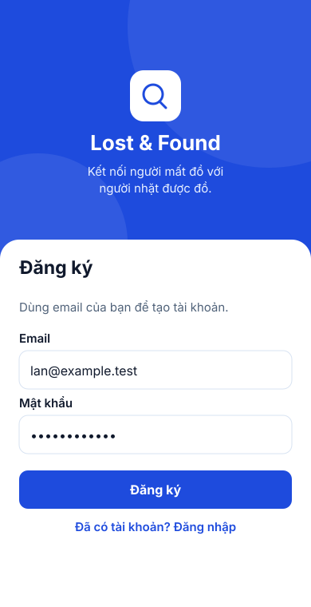

**SCR ID chưa được cấp.** Khách chọn Đăng ký → nhập email và mật khẩu → chọn Đăng ký để gửi. [Về đặc tả UC-01 · Bước 1](uc-01.md#main-flow). Nghiệm thu [SCN-UC01-01](uc-01.md#scn-uc01-01), [SCN-UC01-02](uc-01.md#scn-uc01-02).

### Đang gửi đăng ký

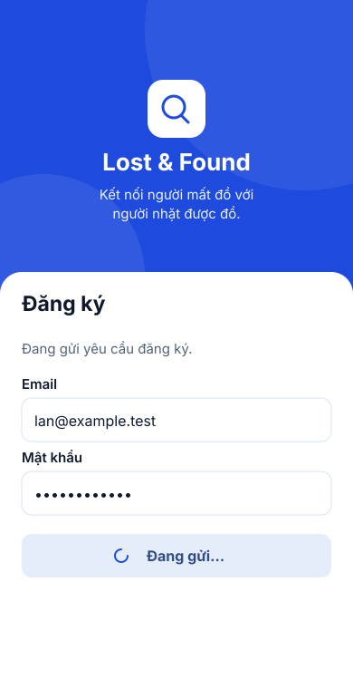

**SCR ID chưa được cấp.** Sau khi gửi form, khóa thao tác lặp. `202` → Kiểm tra email. `400` → lỗi dữ liệu. `503` hoặc lỗi kết nối → thử lại. [Về đặc tả UC-01 · Bước 1–2](uc-01.md#main-flow). Nghiệm thu [SCN-UC01-01](uc-01.md#scn-uc01-01), [SCN-UC01-02](uc-01.md#scn-uc01-02).

### Dữ liệu đăng ký cần sửa

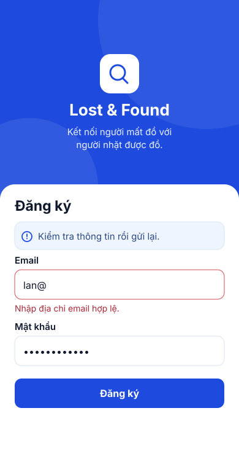

**SCR ID chưa được cấp.** Trường được xác định là sai → chỉ lỗi cạnh trường. Với `400` chung, hiện thông báo gần nút và giữ form để sửa. [Về đặc tả UC-01 · E5](uc-01.md#exception-flows). Nghiệm thu [SCN-UC01-08](uc-01.md#scn-uc01-08).

### Thử lại đăng ký

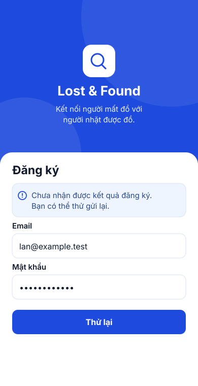

**SCR ID chưa được cấp.** `503` hoặc mất kết nối → giữ form và cho thử lại. Phản hồi mới áp dụng cho lần gửi hiện hành. [Về đặc tả UC-01 · E6](uc-01.md#exception-flows). Nghiệm thu [SCN-UC01-08](uc-01.md#scn-uc01-08).

### Kiểm tra email

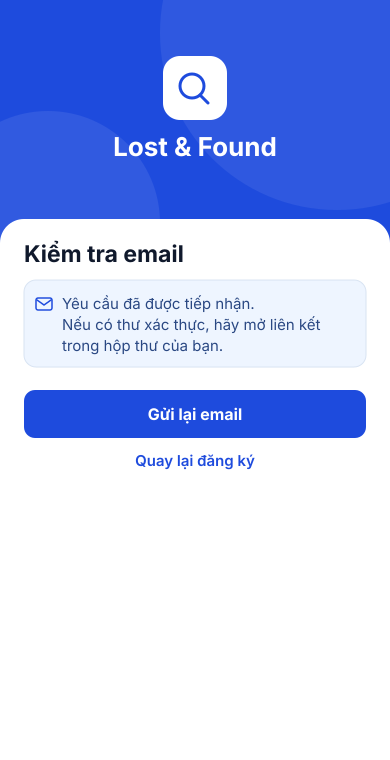

**SCR ID chưa được cấp.** `202` từ đăng ký hoặc gửi lại → cùng một màn. Khách có thể mở ứng dụng email hoặc đi tới màn gửi lại. Khi chưa có thư, giữ thông báo tiếp nhận. [Về đặc tả UC-01 · Bước 2, A1, A2, E3](uc-01.md#alternative-flows). Nghiệm thu [SCN-UC01-01](uc-01.md#scn-uc01-01), [SCN-UC01-02](uc-01.md#scn-uc01-02), [SCN-UC01-05](uc-01.md#scn-uc01-05), [SCN-UC01-07](uc-01.md#scn-uc01-07).

### Mở thư xác thực

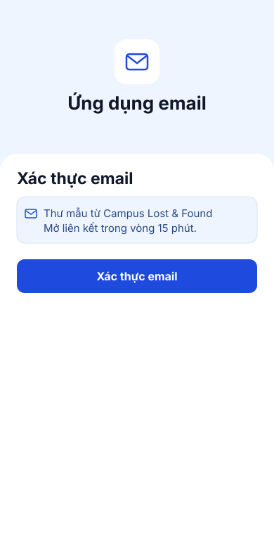

**SCR ID chưa được cấp.** Màn ngoài ứng dụng. Khách mở liên kết trong thư → đến điểm đích được cấu hình, rồi client gửi token để xác thực. [Về đặc tả UC-01 · Bước 3–4](uc-01.md#main-flow). Nghiệm thu [SCN-UC01-02](uc-01.md#scn-uc01-02), [SCN-UC01-03](uc-01.md#scn-uc01-03), [SCN-UC01-04](uc-01.md#scn-uc01-04).

### Đang xác thực

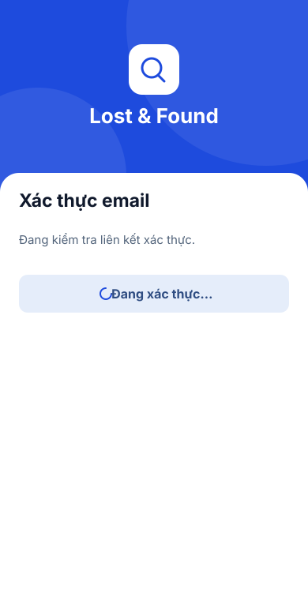

**SCR ID chưa được cấp.** Client đã nhận token và đang gửi. `204` → thành công. `410` → liên kết không còn hiệu lực. `400` → liên kết không hợp lệ. `503` hoặc mất kết nối → thử lại. [Về đặc tả UC-01 · Bước 4](uc-01.md#main-flow). Nghiệm thu [SCN-UC01-03](uc-01.md#scn-uc01-03), [SCN-UC01-04](uc-01.md#scn-uc01-04), [SCN-UC01-08](uc-01.md#scn-uc01-08).

### Email đã được xác thực

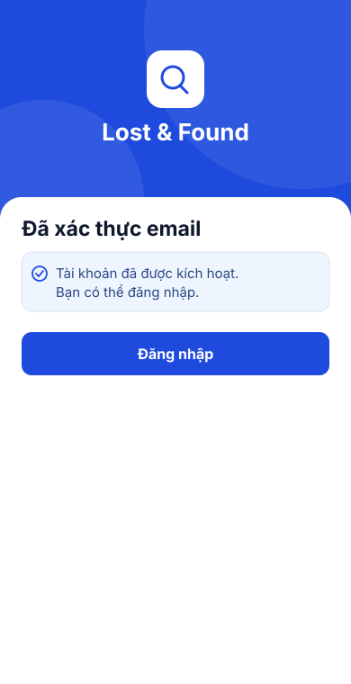

**SCR ID chưa được cấp.** `204` → xác nhận tài khoản hoạt động. Chọn Đăng nhập → màn UC02. [Về đặc tả UC-01 · Bước 5](uc-01.md#main-flow). Nghiệm thu [SCN-UC01-03](uc-01.md#scn-uc01-03).

### Liên kết không dùng được

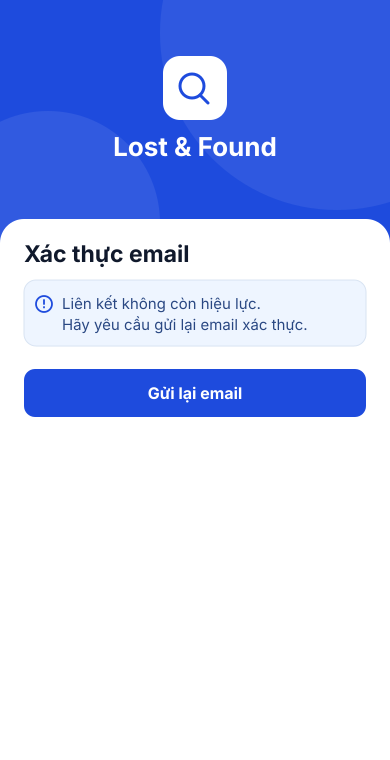

**SCR ID chưa được cấp.** Khi nhận `410`, khách có thể yêu cầu gửi lại. Việc mở lại liên kết đã dùng không thay đổi trạng thái tài khoản. [Về đặc tả UC-01 · E1](uc-01.md#exception-flows). Nghiệm thu [SCN-UC01-03](uc-01.md#scn-uc01-03), [SCN-UC01-04](uc-01.md#scn-uc01-04).

### Liên kết không hợp lệ

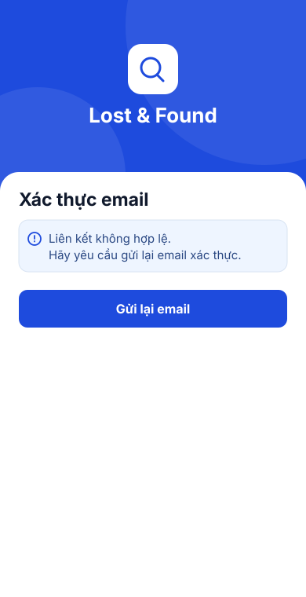

**SCR ID chưa được cấp.** Nếu yêu cầu xác thực thiếu token hợp lệ hoặc Core trả `400` vì dữ liệu đầu vào, khách có thể chọn “Gửi lại email”. [Về đặc tả UC-01 · E5](uc-01.md#exception-flows). Nghiệm thu [SCN-UC01-08](uc-01.md#scn-uc01-08).

### Thử lại xác thực

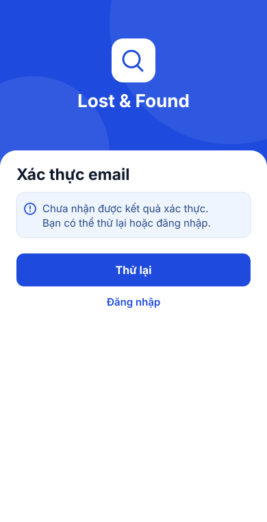

**SCR ID chưa được cấp.** `503` hoặc mất kết nối → cho gọi lại khi còn token trong ngữ cảnh hoặc chuyển UC02. Core quyết định kết quả theo trạng thái token và tài khoản. [Về đặc tả UC-01 · E6](uc-01.md#exception-flows). Nghiệm thu [SCN-UC01-08](uc-01.md#scn-uc01-08).

### Yêu cầu gửi lại email

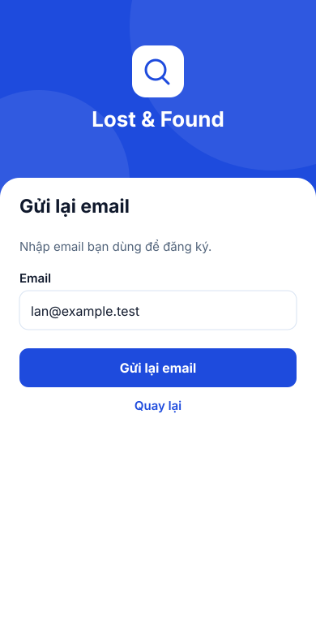

**SCR ID chưa được cấp.** Mở từ Kiểm tra email hoặc lỗi liên kết. Khách xác nhận hoặc sửa email rồi gửi yêu cầu. [Về đặc tả UC-01 · A2](uc-01.md#alternative-flows). Nghiệm thu [SCN-UC01-04](uc-01.md#scn-uc01-04), [SCN-UC01-05](uc-01.md#scn-uc01-05).

### Đang gửi yêu cầu gửi lại

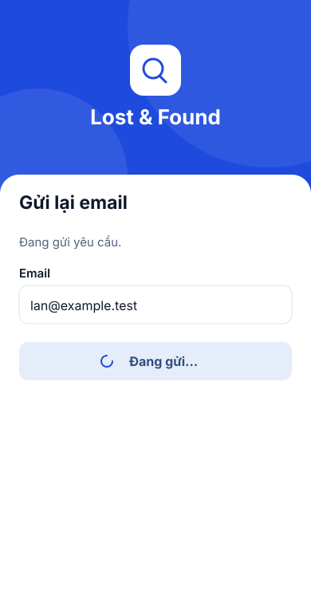

**SCR ID chưa được cấp.** Yêu cầu đang chờ. `202` → Kiểm tra email. `429` → chờ gửi lại. `400` → lỗi dữ liệu. `503` hoặc mất kết nối → thử lại. [Về đặc tả UC-01 · A2](uc-01.md#alternative-flows). Nghiệm thu [SCN-UC01-05](uc-01.md#scn-uc01-05).

### Email gửi lại cần sửa

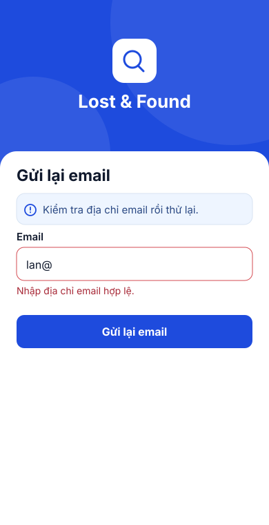

**SCR ID chưa được cấp.** Email không hợp lệ hoặc `400` → khách sửa email rồi gửi lại. [Về đặc tả UC-01 · E5](uc-01.md#exception-flows). Nghiệm thu [SCN-UC01-08](uc-01.md#scn-uc01-08).

### Thử lại yêu cầu gửi email

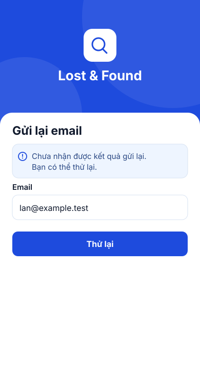

**SCR ID chưa được cấp.** `503` hoặc mất kết nối → giữ email, cho thử lại. Core vẫn thực thi hạn mức. [Về đặc tả UC-01 · E6](uc-01.md#exception-flows). Nghiệm thu [SCN-UC01-08](uc-01.md#scn-uc01-08).

### Chờ trước khi gửi lại

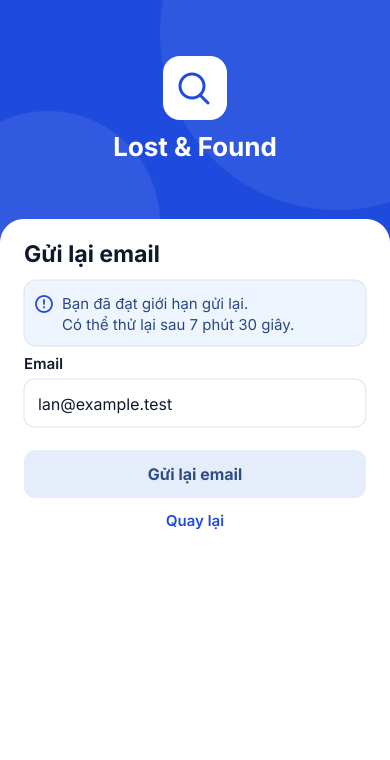

**SCR ID chưa được cấp.** `429` → khóa gửi lại cho email tương ứng tới mốc từ `Retry-After`. Hình dùng giá trị mẫu 450 giây. Khi đủ thời gian, trở về trạng thái cho phép gửi. [Về đặc tả UC-01 · E2](uc-01.md#exception-flows). Nghiệm thu [SCN-UC01-05](uc-01.md#scn-uc01-05).

### Đăng nhập bị từ chối

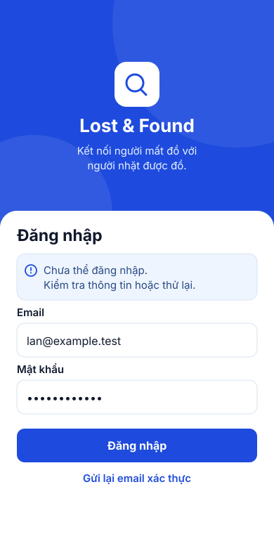

**SCR ID chưa được cấp.** Biến thể bàn giao UC02. Khi chưa có phiên, hiển thị thông báo chung từ luồng đăng nhập. Liên kết gửi lại mở màn UC01 và không khẳng định lý do từ chối. [Về đặc tả UC-01 · E4](uc-01.md#exception-flows). Nghiệm thu [SCN-UC01-06](uc-01.md#scn-uc01-06).
