# UI UC-02 · Hồ sơ và Mục của tôi

**UI v2 · Đã duyệt** · Người dùng xác nhận ngày 2026-11-22 · [UC spec v2](uc-02-profile-and-my-items.md)

Phạm vi duyệt gồm bộ hình Essential với Hồ sơ và ba tab Mục của tôi trên cùng màn, nút Đăng xuất xanh đậm ở đáy màn và hộp thoại xác nhận dùng chung với UC-01.

Ảnh PNG minh họa được dựng bằng HTML/CSS và xuất cục bộ ở khung 390 × 760 bằng Chromium. Tên, email, mục, trạng thái và hình minh họa đều là dữ liệu mẫu. [Bản dựng cục bộ](ui/essential-preview.html) có từng trạng thái để đối chiếu. Bộ này phục vụ duyệt thiết kế và luồng. Nghiệm thu hiển thị native và hành vi trên thiết bị thuộc các SCN của UC.

- [SRS trang 2](../requirements/lost-and-found-srs.pdf#page=2) cấp mã SCR. [Mockup trang 3](../requirements/lost-and-found-srs.pdf#page=3) cung cấp mẫu thẻ hồ sơ, tab, hàng, rỗng, lỗi và hộp thoại. [Quyết định bố cục ngày 2026-11-22](../requirements/analysis/uc-01-02.md#uc-02-profile-layout) áp dụng bố cục chung của mockup với thông tin Hồ sơ (SCR-02) và phần Mục của tôi (SCR-03) trên cùng màn. Đăng xuất màu xanh đậm nằm ở đáy màn ngoài vùng cuộn của danh sách. App hiện tại dùng lối vào hai bước theo bundle v1. Ngày tham gia, số đếm, mở lại dữ liệu ngoại tuyến và nút đăng bài của mockup thuộc phạm vi hoãn hoặc UC khác.
- [Ghi chú hợp đồng UC-02](../api/core/uc-02-notes.md#nghiệp-vụ-và-bàn-giao-uc-spec) và [OpenAPI](../api/core/openapi.json#L311) quyết định dữ liệu và trạng thái Essential. Thiết kế đối chiếu [my-area-screens.tsx](../../apps/mobile/src/my-area-screens.tsx) và [my-area-flow.ts](../../apps/mobile/src/my-area-flow.ts). Phiên bản nguồn được ghim tại [UC spec](uc-02-profile-and-my-items.md#nguồn).
- Mỗi ảnh danh sách minh họa một vùng nhìn, có thể chỉ hiện một phần của trang. Mốc 20 mục, cursor và phép thử 0/20/21 vẫn theo SCN-PRF-07/08. Chỉ báo làm mới minh họa hành vi kéo trên app native.

Xem nhanh [Hồ sơ](#scr-02-ready), [Bài báo mất](#scr-03-lost-ready), [Bài báo nhặt](#scr-03-found-ready), [Yêu cầu nhận đồ](#scr-03-claims-ready) và [các quyết định còn mở](#các-quyết-định-còn-mở).

## Điều hướng và Hồ sơ

### Trang chính · Chưa gán SCR · Vào ứng dụng

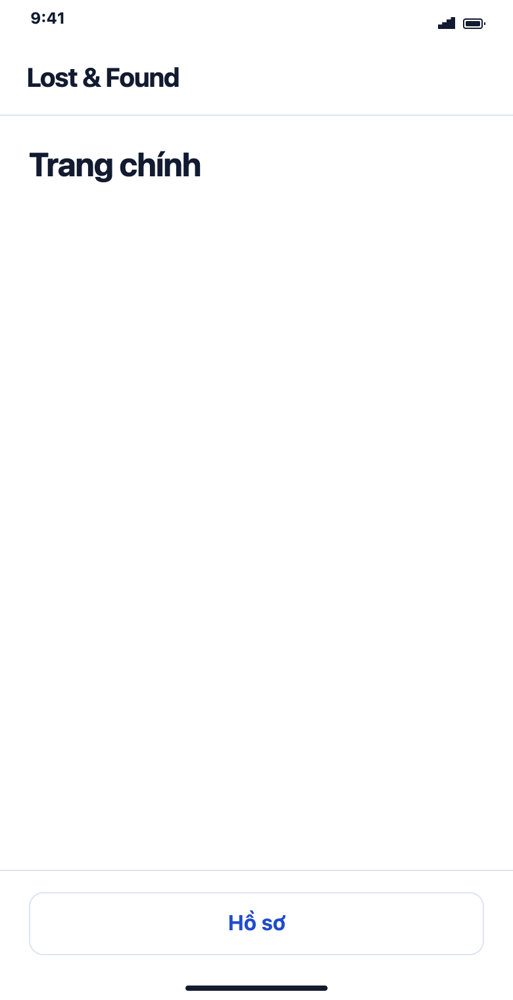

**Hồ sơ** mở SCR-02. Bố cục minh họa lối vào Essential. App hiện tại có thêm nút **Đăng xuất** ở Trang chính. Phương án trình duyệt dùng lối đăng xuất qua Hồ sơ, theo điểm kích hoạt SCR-04 của SCN-AUTH-15. Đối chiếu [luồng chính](uc-02-profile-and-my-items.md#giao-dien-main), [luồng thay thế](uc-02-profile-and-my-items.md#giao-dien-alt) và SCN-AUTH-04/11 và SCN-PRF-03/16.

### SCR-02 · Hồ sơ đang tải

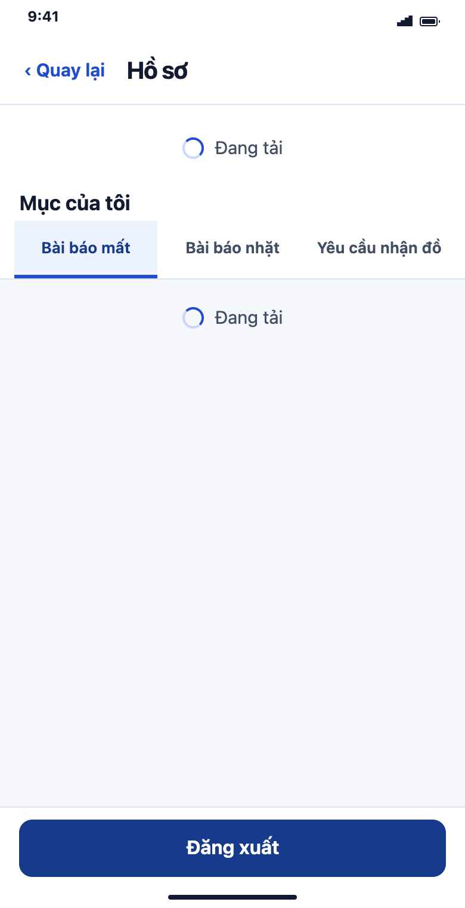

Hồ sơ và tab mặc định cùng tải sau lần chạm vào Hồ sơ. Nút **Đăng xuất** hiện ở đáy màn. Đối chiếu [luồng chính](uc-02-profile-and-my-items.md#giao-dien-main), [luồng ngoại lệ](uc-02-profile-and-my-items.md#giao-dien-error) và SCN-PRF-01/03/11/17.

### SCR-02 · Hồ sơ có dữ liệu

Ảnh mẫu, tên và email. Ba tab **Mục của tôi** xuất hiện dưới thông tin hồ sơ. Nút **Đăng xuất** màu xanh đậm ở đáy màn mở SCR-04. **Quay lại** trở về Trang chính. Đối chiếu [luồng chính](uc-02-profile-and-my-items.md#giao-dien-main), [luồng thay thế](uc-02-profile-and-my-items.md#giao-dien-alt) và SCN-PRF-01/03/16/17 và SCN-AUTH-15.

### SCR-02 · Hồ sơ dùng ảnh thay thế

Khi avatar thiếu, đang tải hoặc tải lỗi, ảnh thay thế giữ nguyên tên, email và các thao tác. Đối chiếu [luồng thay thế](uc-02-profile-and-my-items.md#giao-dien-alt) và SCN-PRF-02/17.

### SCR-02 · Hồ sơ lỗi mất mạng

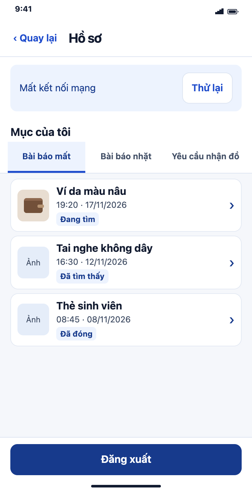

**Thử lại** gọi lại lượt đọc hồ sơ. Hình minh họa lúc chưa có hồ sơ được hiển thị. Đối chiếu [luồng ngoại lệ](uc-02-profile-and-my-items.md#giao-dien-error) và SCN-PRF-11.

### SCR-02 · Hồ sơ lỗi máy chủ hoặc timeout

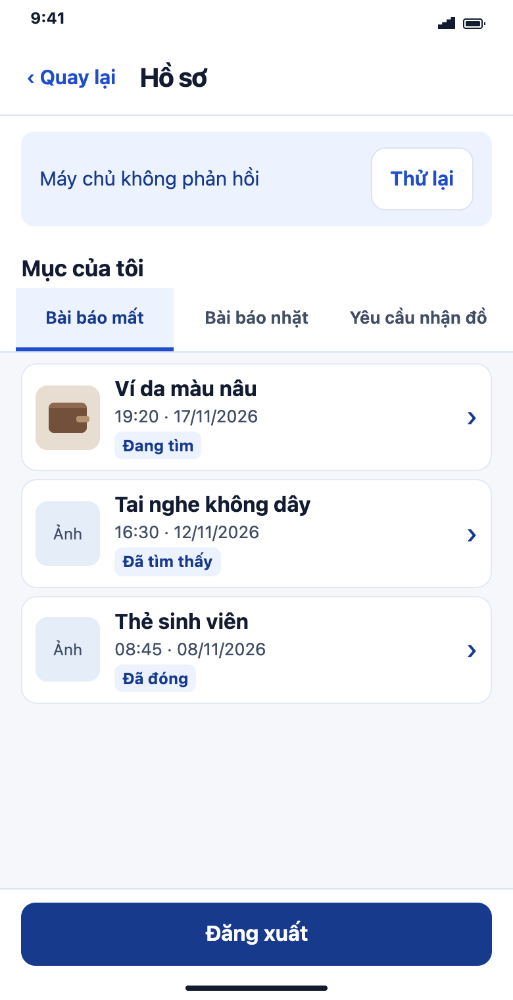

**Thử lại** gọi lại lượt đọc hồ sơ. Hình minh họa lúc chưa có hồ sơ được hiển thị. Đối chiếu [luồng ngoại lệ](uc-02-profile-and-my-items.md#giao-dien-error) và SCN-PRF-11.

### SCR-02 · Hồ sơ đã có dữ liệu, mất mạng

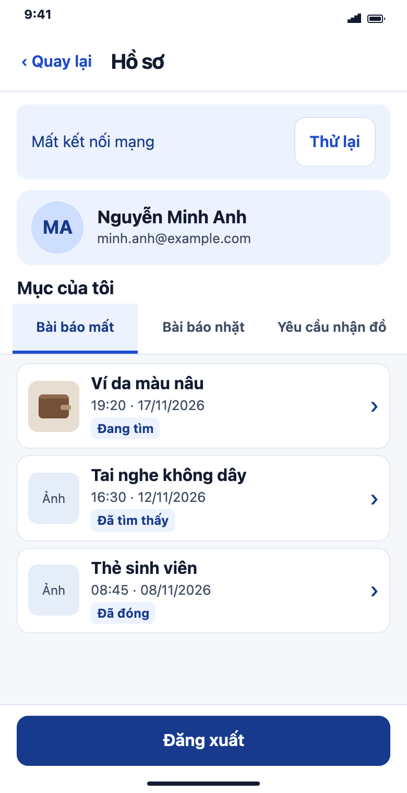

Nếu một lượt đọc lỗi khi dữ liệu của phiên hiện hành đã hiển thị, giữ thẻ hồ sơ và thêm **Thử lại**. Mô phỏng quy tắc FR-PRF-13. Luồng mở hồ sơ thông thường trong app hiện bắt đầu bằng tải mới. Đối chiếu [luồng ngoại lệ](uc-02-profile-and-my-items.md#giao-dien-error) và SCN-PRF-11.

### SCR-02 · Hồ sơ đã có dữ liệu, máy chủ không phản hồi

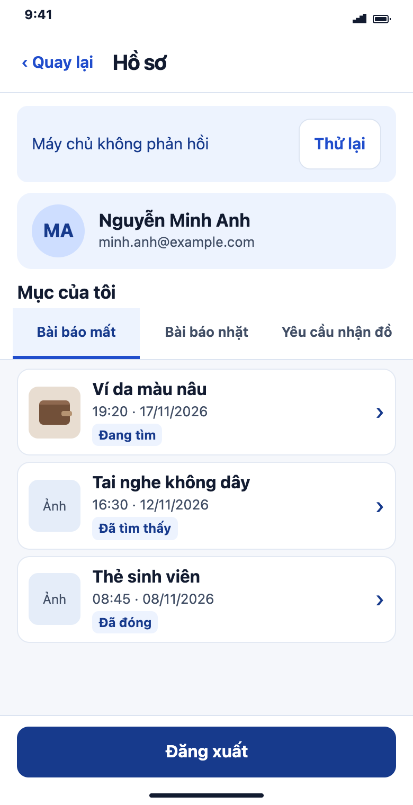

Giữ cùng nội dung hồ sơ và thêm **Thử lại** khi timeout hoặc lỗi máy chủ. Đối chiếu [luồng ngoại lệ](uc-02-profile-and-my-items.md#giao-dien-error) và SCN-PRF-11.

## Phần SCR-03 · Bài báo mất

### Phần SCR-03 · Bài báo mất · Đang tải trang đầu

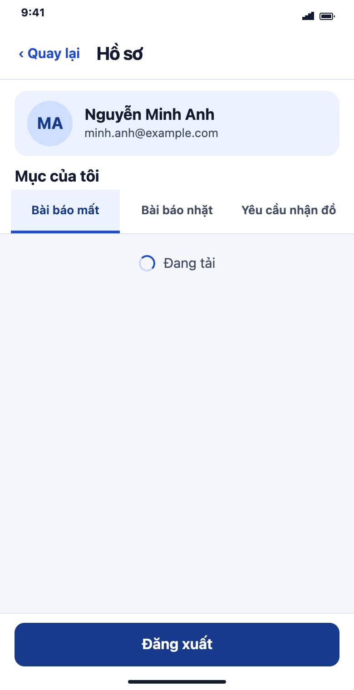

Chỉ báo tải trong tab đang chọn. Khi vào Hồ sơ, tab Bài báo mất được chọn mặc định. Đổi tab yêu cầu trang đầu của tab mới. Đối chiếu [luồng chính](uc-02-profile-and-my-items.md#giao-dien-main), [luồng thay thế](uc-02-profile-and-my-items.md#giao-dien-alt) và SCN-PRF-03–06/10/17.

### Phần SCR-03 · Bài báo mất · Có dữ liệu, còn trang

Danh sách theo thứ tự Core trả về. Khi cuộn tới cuối và còn cursor, Mobile yêu cầu trang sau. Hàng có tên bài, thời điểm đăng, trạng thái dạng chữ và thumbnail hoặc ảnh thay thế. Chạm hàng mở đích thử nghiệm Lost. Đối chiếu [luồng chính](uc-02-profile-and-my-items.md#giao-dien-main), [luồng thay thế](uc-02-profile-and-my-items.md#giao-dien-alt), [luồng ngoại lệ](uc-02-profile-and-my-items.md#giao-dien-error) và SCN-PRF-04–08/13/14/18.

### Phần SCR-03 · Bài báo mất · Trang đầu rỗng

Thông báo rỗng theo tab. Giữ ba tab và lối Quay lại. Đối chiếu [luồng chính](uc-02-profile-and-my-items.md#giao-dien-main), [luồng thay thế](uc-02-profile-and-my-items.md#giao-dien-alt) và SCN-PRF-07.

### Phần SCR-03 · Bài báo mất · Đang tải trang sau

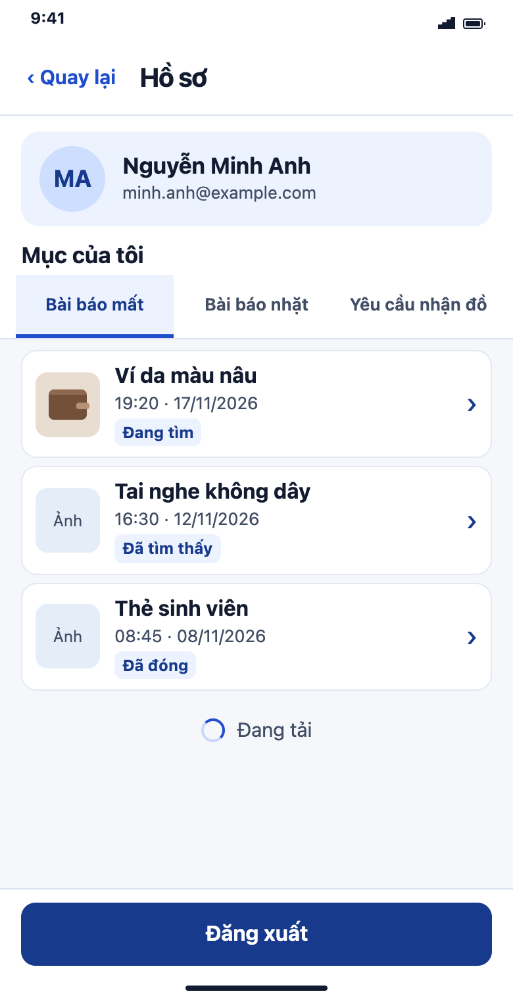

Danh sách hiện tại vẫn hiển thị, chỉ báo tải ở cuối vùng cuộn. App hiện dùng cùng chỉ báo khi đang tự đọc lại trang đầu sau INVALID_CURSOR. Đối chiếu [luồng thay thế](uc-02-profile-and-my-items.md#giao-dien-alt), [luồng ngoại lệ](uc-02-profile-and-my-items.md#giao-dien-error) và SCN-PRF-07–11/17/18.

### Phần SCR-03 · Bài báo mất · Đang làm mới, giữ danh sách

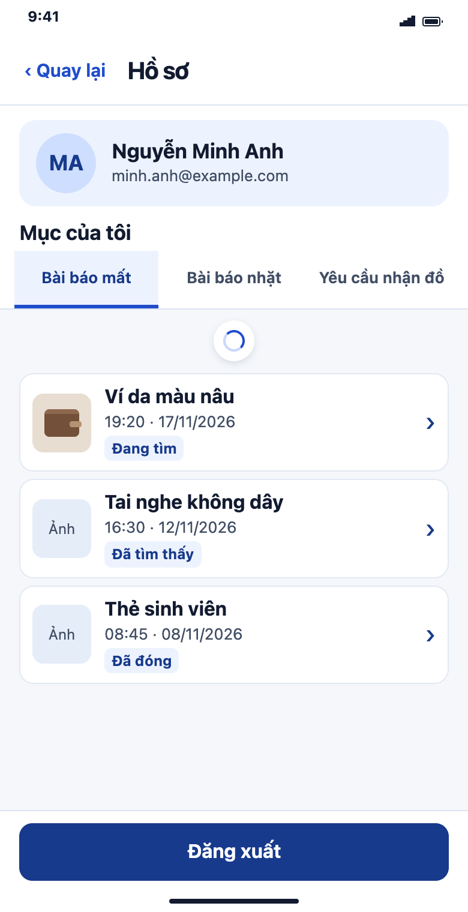

Kéo làm mới đọc trang đầu cùng tab. Chỉ thay dữ liệu và cursor khi lượt hiện hành thành công. Đối chiếu [luồng thay thế](uc-02-profile-and-my-items.md#giao-dien-alt), [luồng ngoại lệ](uc-02-profile-and-my-items.md#giao-dien-error) và SCN-PRF-08/10/11/17/19.

### Phần SCR-03 · Bài báo mất · Đang làm mới từ trang rỗng

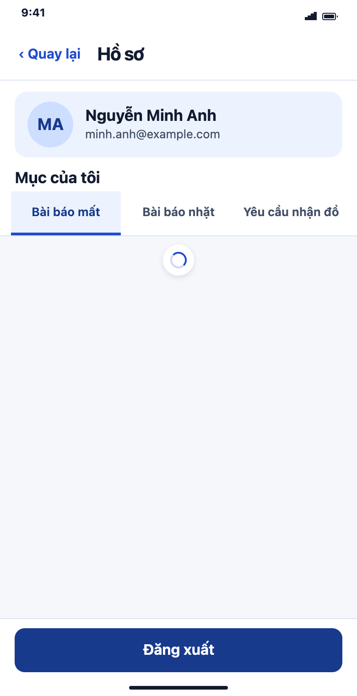

Kéo làm mới trên tab rỗng hiển thị chỉ báo chờ. Kết quả mới quyết định có dữ liệu hay rỗng. Đối chiếu [luồng thay thế](uc-02-profile-and-my-items.md#giao-dien-alt), [luồng ngoại lệ](uc-02-profile-and-my-items.md#giao-dien-error) và SCN-PRF-07/08/10/11.

### Phần SCR-03 · Bài báo mất · Làm mới xong

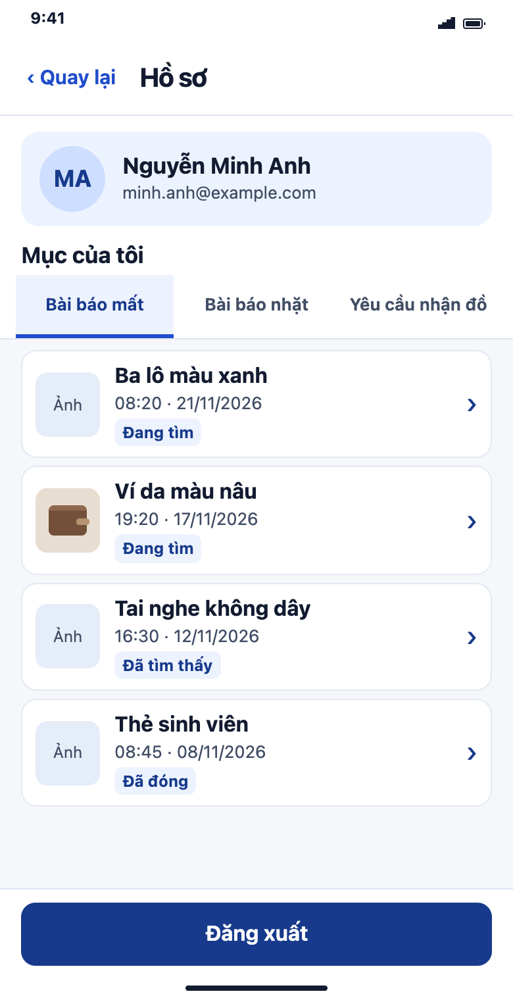

Mục mới của dữ liệu mẫu xuất hiện đầu danh sách. Danh sách và cursor đến từ trang đầu của lượt làm mới hiện hành. Đối chiếu [luồng thay thế](uc-02-profile-and-my-items.md#giao-dien-alt) và SCN-PRF-08/10.

### Phần SCR-03 · Bài báo mất · Đã hiển thị tất cả

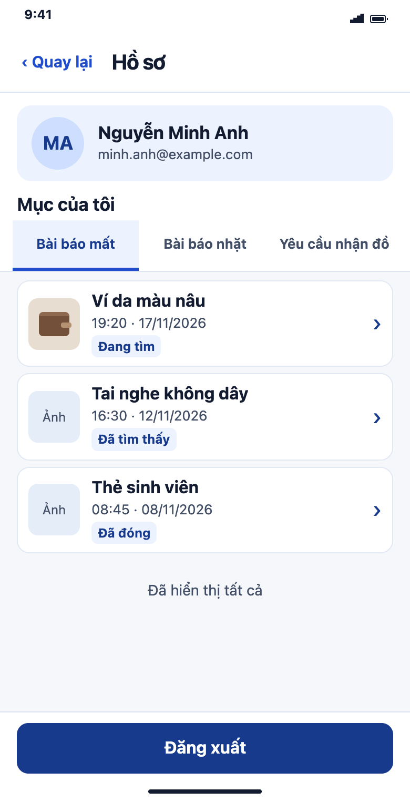

Dòng kết thúc hiện ở cuối danh sách đã có mục khi cursor là null, kể cả khi lần tải cuối trả mảng rỗng. Đối chiếu [luồng chính](uc-02-profile-and-my-items.md#giao-dien-main), [luồng thay thế](uc-02-profile-and-my-items.md#giao-dien-alt) và SCN-PRF-07/08/18.

### Phần SCR-03 · Bài báo mất · Lỗi mất mạng, chưa có mục

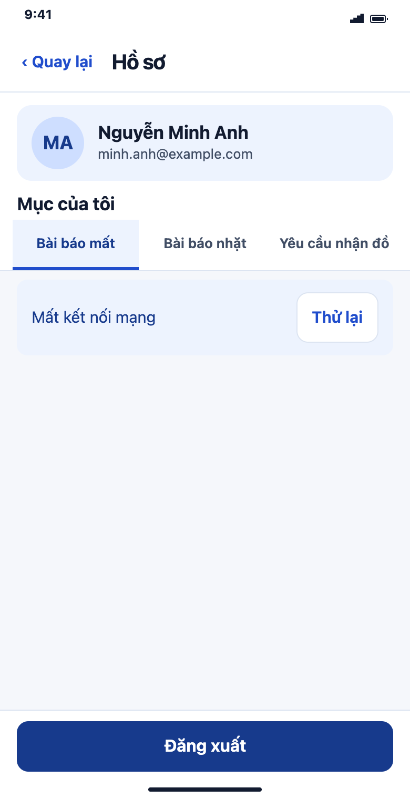

Tab vẫn được đánh dấu. **Thử lại** gửi lại lượt đọc đang lỗi. Đối chiếu [luồng ngoại lệ](uc-02-profile-and-my-items.md#giao-dien-error) và SCN-PRF-11.

### Phần SCR-03 · Bài báo mất · Lỗi máy chủ hoặc timeout, chưa có mục

Tab vẫn được đánh dấu. **Thử lại** gửi lại lượt đọc đang lỗi. Đối chiếu [luồng ngoại lệ](uc-02-profile-and-my-items.md#giao-dien-error) và SCN-PRF-11.

### Phần SCR-03 · Bài báo mất · Lỗi mất mạng, giữ danh sách

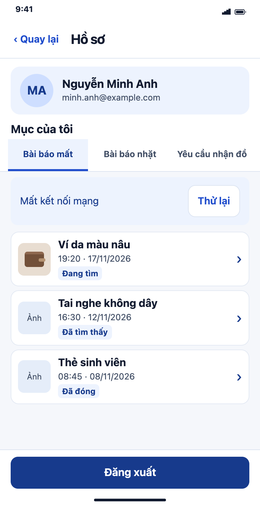

Giữ danh sách của tab và phiên hiện hành. **Thử lại** dùng lượt trang sau hoặc trang đầu, tùy nguồn lỗi. Đối chiếu [luồng ngoại lệ](uc-02-profile-and-my-items.md#giao-dien-error) và SCN-PRF-09–11.

### Phần SCR-03 · Bài báo mất · Lỗi máy chủ hoặc timeout, giữ danh sách

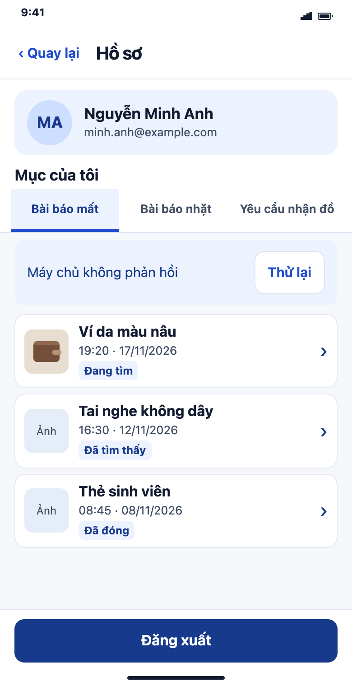

Giữ danh sách đã hiện. **Thử lại** dùng lượt trang sau hoặc trang đầu, tùy nguồn lỗi. Đối chiếu [luồng ngoại lệ](uc-02-profile-and-my-items.md#giao-dien-error) và SCN-PRF-09–11.

## Phần SCR-03 · Bài báo nhặt

### Phần SCR-03 · Bài báo nhặt · Đang tải trang đầu

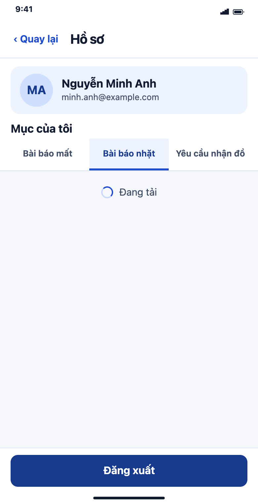

Chỉ báo tải trong tab đang chọn. Khi vào Hồ sơ, tab Bài báo mất được chọn mặc định. Đổi tab yêu cầu trang đầu của tab mới. Đối chiếu [luồng chính](uc-02-profile-and-my-items.md#giao-dien-main), [luồng thay thế](uc-02-profile-and-my-items.md#giao-dien-alt) và SCN-PRF-03–06/10/17.

### Phần SCR-03 · Bài báo nhặt · Có dữ liệu, còn trang

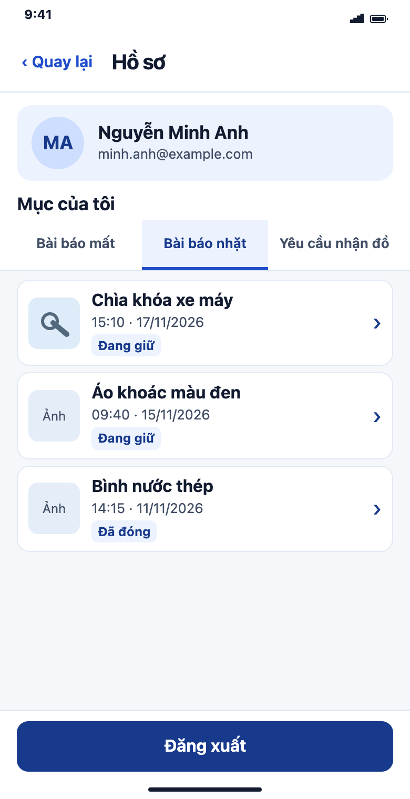

Danh sách theo thứ tự Core trả về. Khi cuộn tới cuối và còn cursor, Mobile yêu cầu trang sau. Hàng có thumbnail mẫu đại diện ảnh đã xử lý hoặc ảnh thay thế khi ảnh thiếu hay lỗi, vẫn mở được đích thử nghiệm Found. Đối chiếu [luồng chính](uc-02-profile-and-my-items.md#giao-dien-main), [luồng thay thế](uc-02-profile-and-my-items.md#giao-dien-alt), [luồng ngoại lệ](uc-02-profile-and-my-items.md#giao-dien-error) và SCN-PRF-04–08/13/14/18.

### Phần SCR-03 · Bài báo nhặt · Trang đầu rỗng

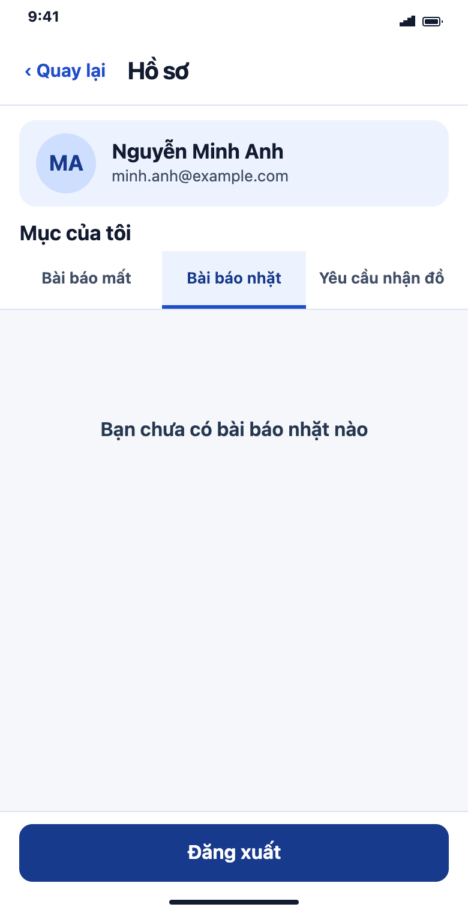

Thông báo rỗng theo tab. Giữ ba tab và lối Quay lại. Đối chiếu [luồng chính](uc-02-profile-and-my-items.md#giao-dien-main), [luồng thay thế](uc-02-profile-and-my-items.md#giao-dien-alt) và SCN-PRF-07.

### Phần SCR-03 · Bài báo nhặt · Đang tải trang sau

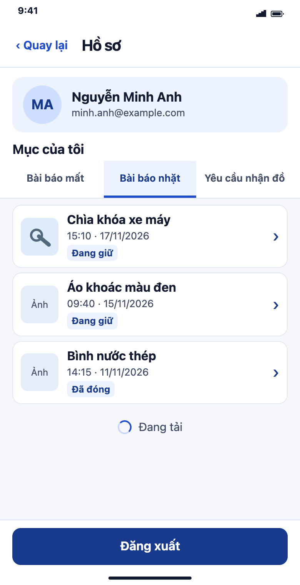

Danh sách hiện tại vẫn hiển thị, chỉ báo tải ở cuối vùng cuộn. App hiện dùng cùng chỉ báo khi đang tự đọc lại trang đầu sau INVALID_CURSOR. Đối chiếu [luồng thay thế](uc-02-profile-and-my-items.md#giao-dien-alt), [luồng ngoại lệ](uc-02-profile-and-my-items.md#giao-dien-error) và SCN-PRF-07–11/17/18.

### Phần SCR-03 · Bài báo nhặt · Đang làm mới, giữ danh sách

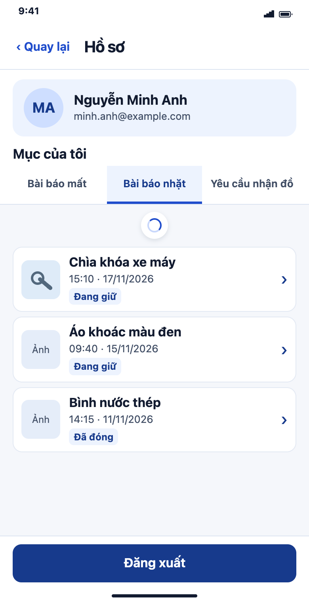

Kéo làm mới đọc trang đầu cùng tab. Chỉ thay dữ liệu và cursor khi lượt hiện hành thành công. Đối chiếu [luồng thay thế](uc-02-profile-and-my-items.md#giao-dien-alt), [luồng ngoại lệ](uc-02-profile-and-my-items.md#giao-dien-error) và SCN-PRF-08/10/11/17/19.

### Phần SCR-03 · Bài báo nhặt · Đang làm mới từ trang rỗng

Kéo làm mới trên tab rỗng hiển thị chỉ báo chờ. Kết quả mới quyết định có dữ liệu hay rỗng. Đối chiếu [luồng thay thế](uc-02-profile-and-my-items.md#giao-dien-alt), [luồng ngoại lệ](uc-02-profile-and-my-items.md#giao-dien-error) và SCN-PRF-07/08/10/11.

### Phần SCR-03 · Bài báo nhặt · Làm mới xong

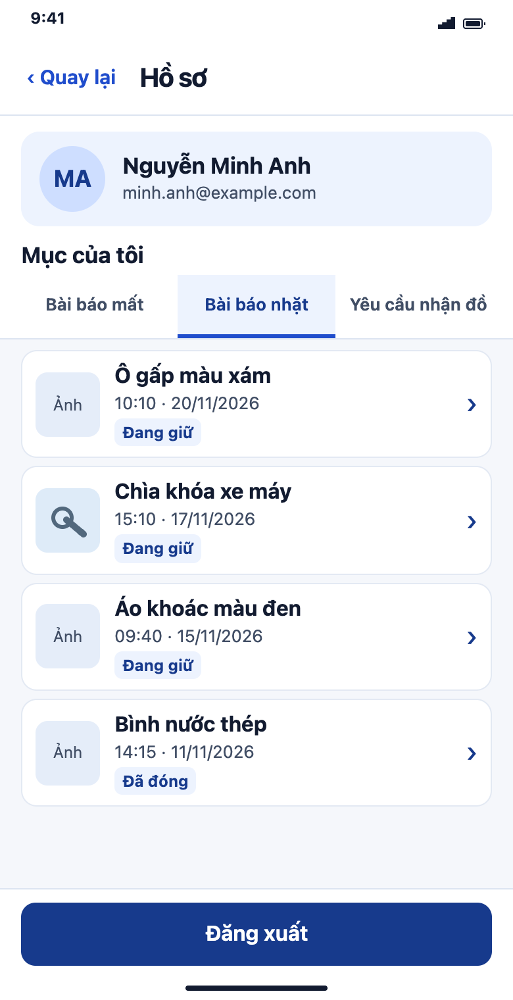

Mục mới của dữ liệu mẫu xuất hiện đầu danh sách. Danh sách và cursor đến từ trang đầu của lượt làm mới hiện hành. Đối chiếu [luồng thay thế](uc-02-profile-and-my-items.md#giao-dien-alt) và SCN-PRF-08/10.

### Phần SCR-03 · Bài báo nhặt · Đã hiển thị tất cả

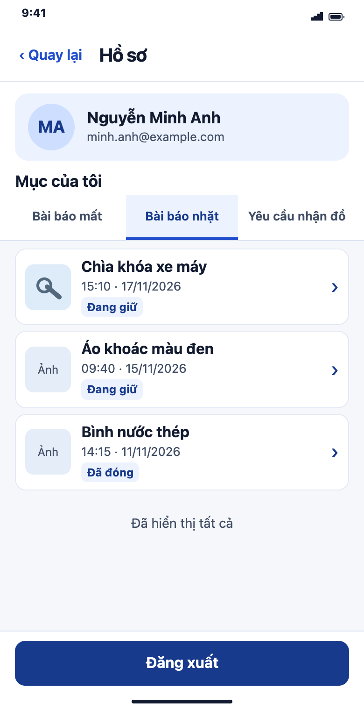

Dòng kết thúc hiện ở cuối danh sách đã có mục khi cursor là null, kể cả khi lần tải cuối trả mảng rỗng. Đối chiếu [luồng chính](uc-02-profile-and-my-items.md#giao-dien-main), [luồng thay thế](uc-02-profile-and-my-items.md#giao-dien-alt) và SCN-PRF-07/08/18.

### Phần SCR-03 · Bài báo nhặt · Lỗi mất mạng, chưa có mục

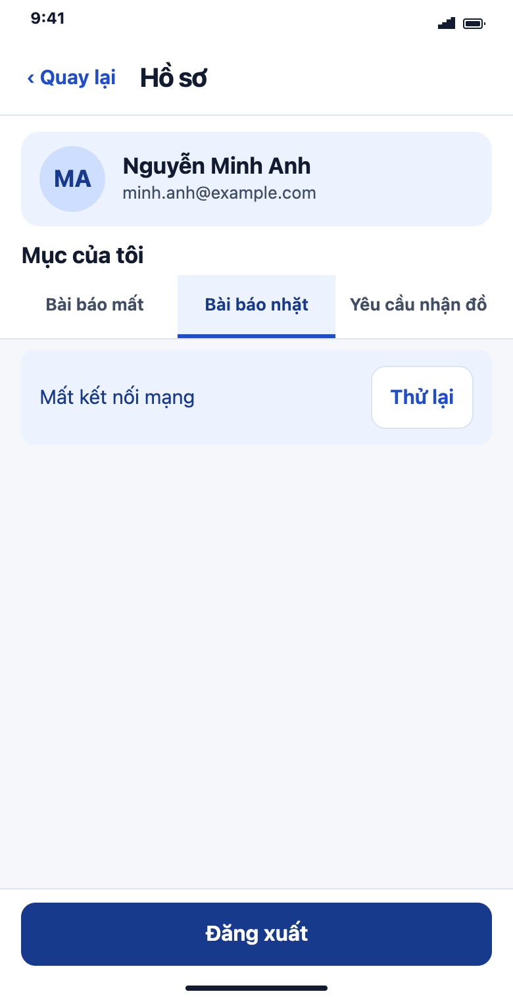

Tab vẫn được đánh dấu. **Thử lại** gửi lại lượt đọc đang lỗi. Đối chiếu [luồng ngoại lệ](uc-02-profile-and-my-items.md#giao-dien-error) và SCN-PRF-11.

### Phần SCR-03 · Bài báo nhặt · Lỗi máy chủ hoặc timeout, chưa có mục

Tab vẫn được đánh dấu. **Thử lại** gửi lại lượt đọc đang lỗi. Đối chiếu [luồng ngoại lệ](uc-02-profile-and-my-items.md#giao-dien-error) và SCN-PRF-11.

### Phần SCR-03 · Bài báo nhặt · Lỗi mất mạng, giữ danh sách

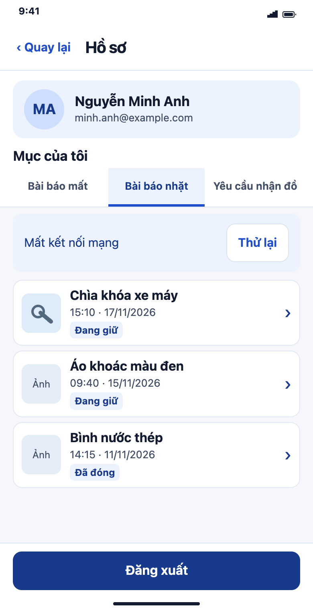

Giữ danh sách của tab và phiên hiện hành. **Thử lại** dùng lượt trang sau hoặc trang đầu, tùy nguồn lỗi. Đối chiếu [luồng ngoại lệ](uc-02-profile-and-my-items.md#giao-dien-error) và SCN-PRF-09–11.

### Phần SCR-03 · Bài báo nhặt · Lỗi máy chủ hoặc timeout, giữ danh sách

Giữ danh sách đã hiện. **Thử lại** dùng lượt trang sau hoặc trang đầu, tùy nguồn lỗi. Đối chiếu [luồng ngoại lệ](uc-02-profile-and-my-items.md#giao-dien-error) và SCN-PRF-09–11.

## Phần SCR-03 · Yêu cầu nhận đồ

### Phần SCR-03 · Yêu cầu nhận đồ · Đang tải trang đầu

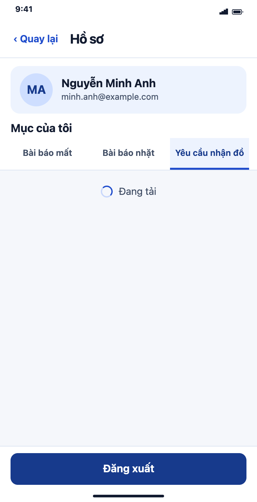

Chỉ báo tải trong tab đang chọn. Khi vào Hồ sơ, tab Bài báo mất được chọn mặc định. Đổi tab yêu cầu trang đầu của tab mới. Đối chiếu [luồng chính](uc-02-profile-and-my-items.md#giao-dien-main), [luồng thay thế](uc-02-profile-and-my-items.md#giao-dien-alt) và SCN-PRF-03–06/10/17.

### Phần SCR-03 · Yêu cầu nhận đồ · Có dữ liệu, còn trang

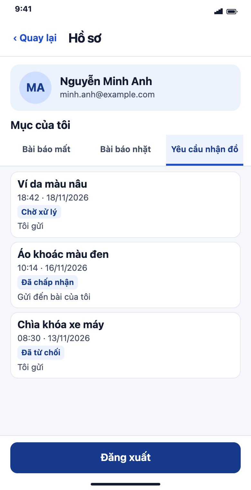

Danh sách theo thứ tự Core trả về. Khi cuộn tới cuối và còn cursor, Mobile yêu cầu trang sau. Mỗi hàng có tên, thời điểm gửi, trạng thái dạng chữ và vai trò. Hai vai trò mẫu là “Tôi gửi” và “Gửi đến bài của tôi”. Hàng chỉ đọc. Đối chiếu [luồng chính](uc-02-profile-and-my-items.md#giao-dien-main), [luồng thay thế](uc-02-profile-and-my-items.md#giao-dien-alt), [luồng ngoại lệ](uc-02-profile-and-my-items.md#giao-dien-error) và SCN-PRF-04–08/13/14/18.

### Phần SCR-03 · Yêu cầu nhận đồ · Trang đầu rỗng

Thông báo rỗng theo tab. Giữ ba tab và lối Quay lại. Đối chiếu [luồng chính](uc-02-profile-and-my-items.md#giao-dien-main), [luồng thay thế](uc-02-profile-and-my-items.md#giao-dien-alt) và SCN-PRF-07.

### Phần SCR-03 · Yêu cầu nhận đồ · Đang tải trang sau

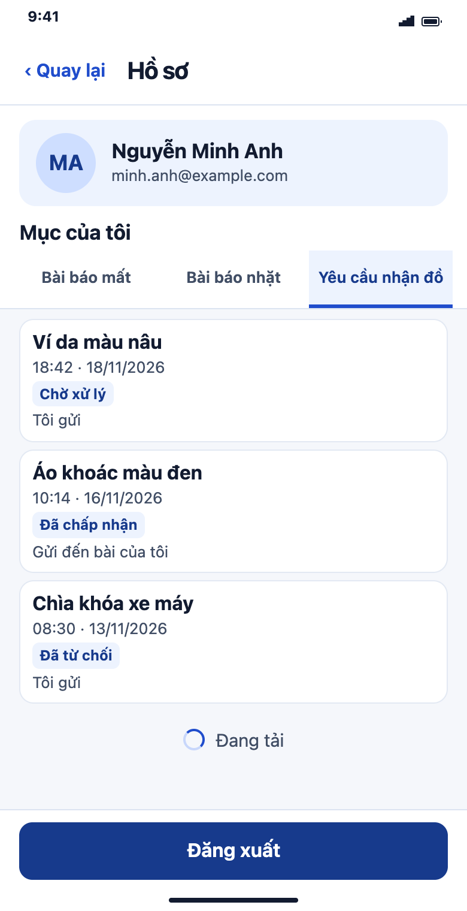

Danh sách hiện tại vẫn hiển thị, chỉ báo tải ở cuối vùng cuộn. App hiện dùng cùng chỉ báo khi đang tự đọc lại trang đầu sau INVALID_CURSOR. Đối chiếu [luồng thay thế](uc-02-profile-and-my-items.md#giao-dien-alt), [luồng ngoại lệ](uc-02-profile-and-my-items.md#giao-dien-error) và SCN-PRF-07–11/17/18.

### Phần SCR-03 · Yêu cầu nhận đồ · Đang làm mới, giữ danh sách

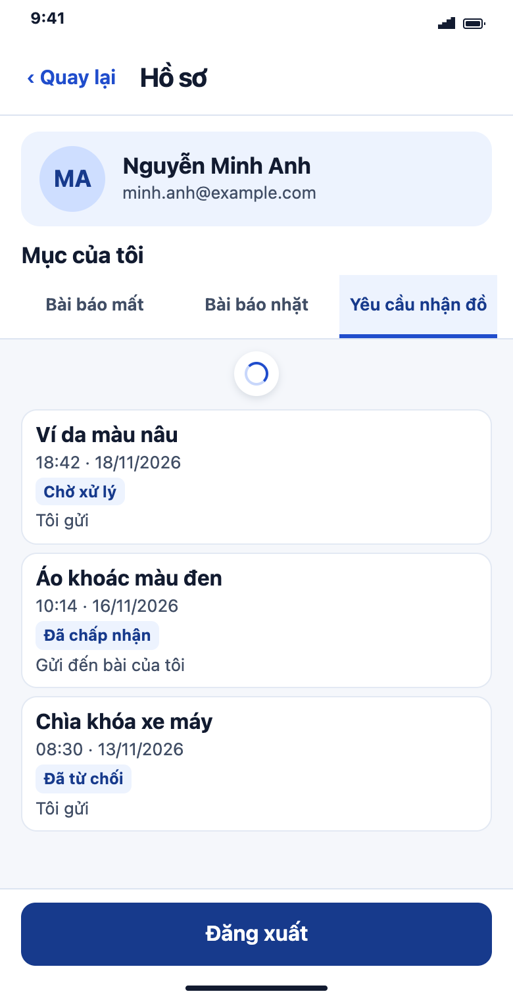

Kéo làm mới đọc trang đầu cùng tab. Chỉ thay dữ liệu và cursor khi lượt hiện hành thành công. Đối chiếu [luồng thay thế](uc-02-profile-and-my-items.md#giao-dien-alt), [luồng ngoại lệ](uc-02-profile-and-my-items.md#giao-dien-error) và SCN-PRF-08/10/11/17/19.

### Phần SCR-03 · Yêu cầu nhận đồ · Đang làm mới từ trang rỗng

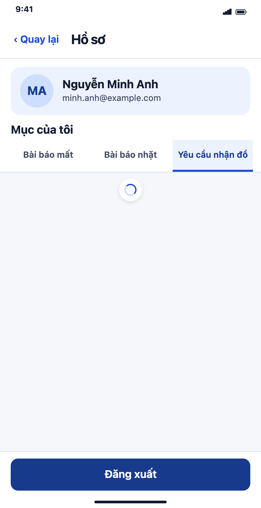

Kéo làm mới trên tab rỗng hiển thị chỉ báo chờ. Kết quả mới quyết định có dữ liệu hay rỗng. Đối chiếu [luồng thay thế](uc-02-profile-and-my-items.md#giao-dien-alt), [luồng ngoại lệ](uc-02-profile-and-my-items.md#giao-dien-error) và SCN-PRF-07/08/10/11.

### Phần SCR-03 · Yêu cầu nhận đồ · Làm mới xong

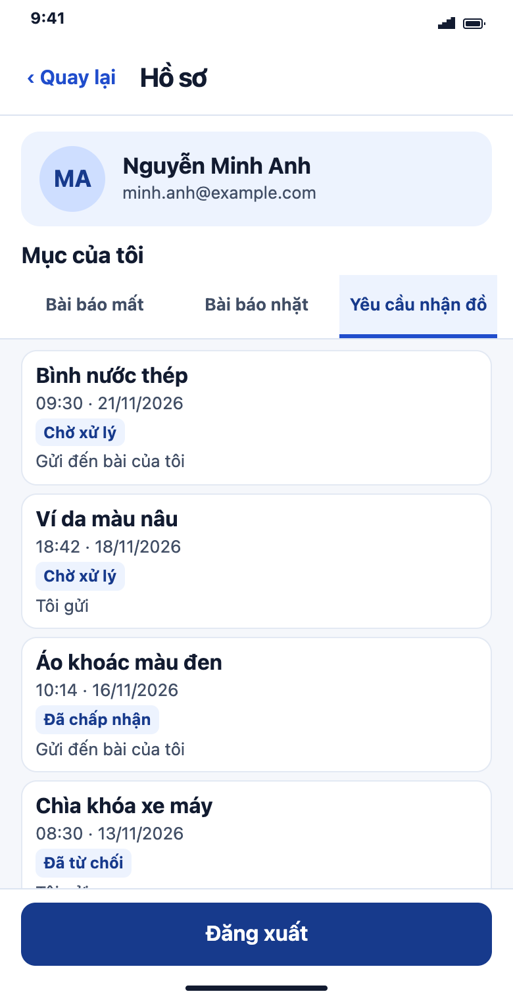

Mục mới của dữ liệu mẫu xuất hiện đầu danh sách. Danh sách và cursor đến từ trang đầu của lượt làm mới hiện hành. Đối chiếu [luồng thay thế](uc-02-profile-and-my-items.md#giao-dien-alt) và SCN-PRF-08/10.

### Phần SCR-03 · Yêu cầu nhận đồ · Đã hiển thị tất cả

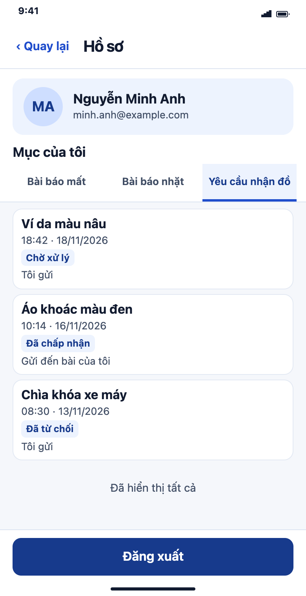

Dòng kết thúc hiện ở cuối danh sách đã có mục khi cursor là null, kể cả khi lần tải cuối trả mảng rỗng. Đối chiếu [luồng chính](uc-02-profile-and-my-items.md#giao-dien-main), [luồng thay thế](uc-02-profile-and-my-items.md#giao-dien-alt) và SCN-PRF-07/08/18.

### Phần SCR-03 · Yêu cầu nhận đồ · Lỗi mất mạng, chưa có mục

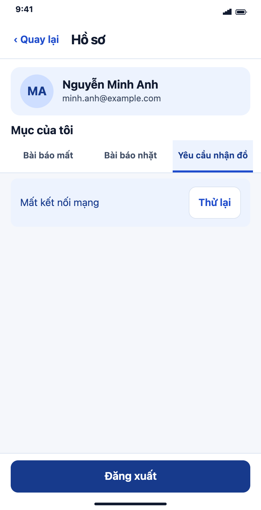

Tab vẫn được đánh dấu. **Thử lại** gửi lại lượt đọc đang lỗi. Đối chiếu [luồng ngoại lệ](uc-02-profile-and-my-items.md#giao-dien-error) và SCN-PRF-11.

### Phần SCR-03 · Yêu cầu nhận đồ · Lỗi máy chủ hoặc timeout, chưa có mục

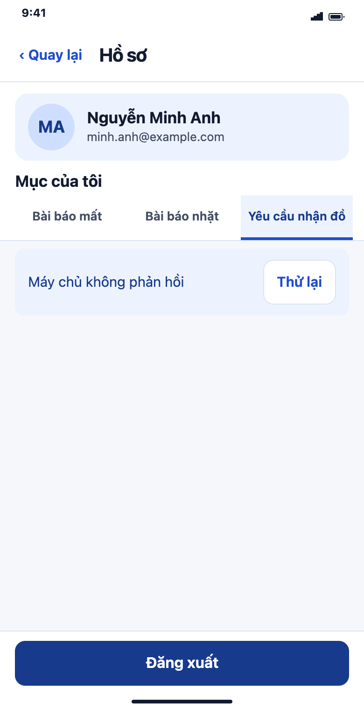

Tab vẫn được đánh dấu. **Thử lại** gửi lại lượt đọc đang lỗi. Đối chiếu [luồng ngoại lệ](uc-02-profile-and-my-items.md#giao-dien-error) và SCN-PRF-11.

### Phần SCR-03 · Yêu cầu nhận đồ · Lỗi mất mạng, giữ danh sách

Giữ danh sách của tab và phiên hiện hành. **Thử lại** dùng lượt trang sau hoặc trang đầu, tùy nguồn lỗi. Đối chiếu [luồng ngoại lệ](uc-02-profile-and-my-items.md#giao-dien-error) và SCN-PRF-09–11.

### Phần SCR-03 · Yêu cầu nhận đồ · Lỗi máy chủ hoặc timeout, giữ danh sách

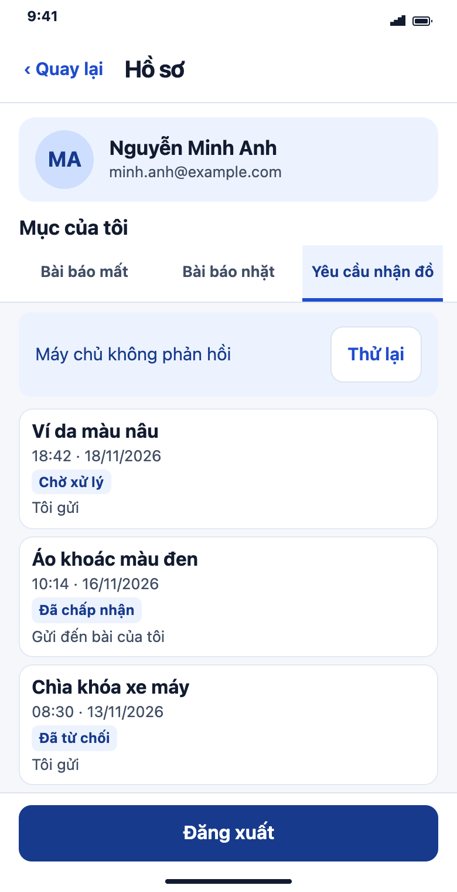

Giữ danh sách đã hiện. **Thử lại** dùng lượt trang sau hoặc trang đầu, tùy nguồn lỗi. Đối chiếu [luồng ngoại lệ](uc-02-profile-and-my-items.md#giao-dien-error) và SCN-PRF-09–11.

## Đích thử nghiệm và trạng thái phiên dùng chung

### Đích từ SCR-03 · Chưa gán SCR · Bài báo mất

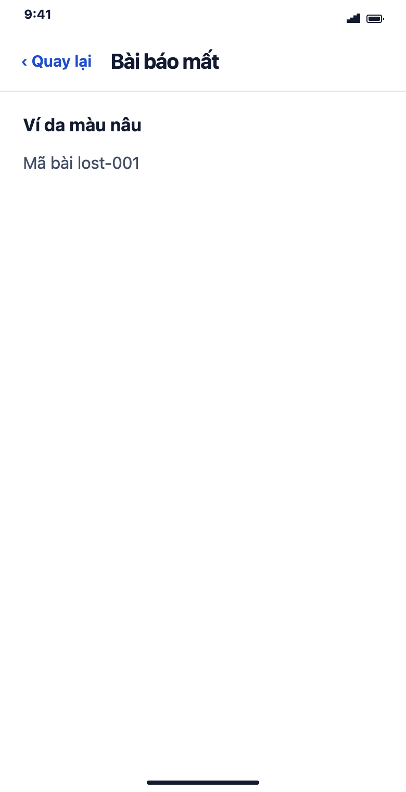

Đích thử nghiệm hiển thị tên và mã bài Lost theo hàng đã chạm. **Quay lại** về Hồ sơ tại tab đang xem. Đối chiếu [luồng thay thế](uc-02-profile-and-my-items.md#giao-dien-alt) và SCN-PRF-13.

### Đích từ SCR-03 · Chưa gán SCR · Bài báo nhặt

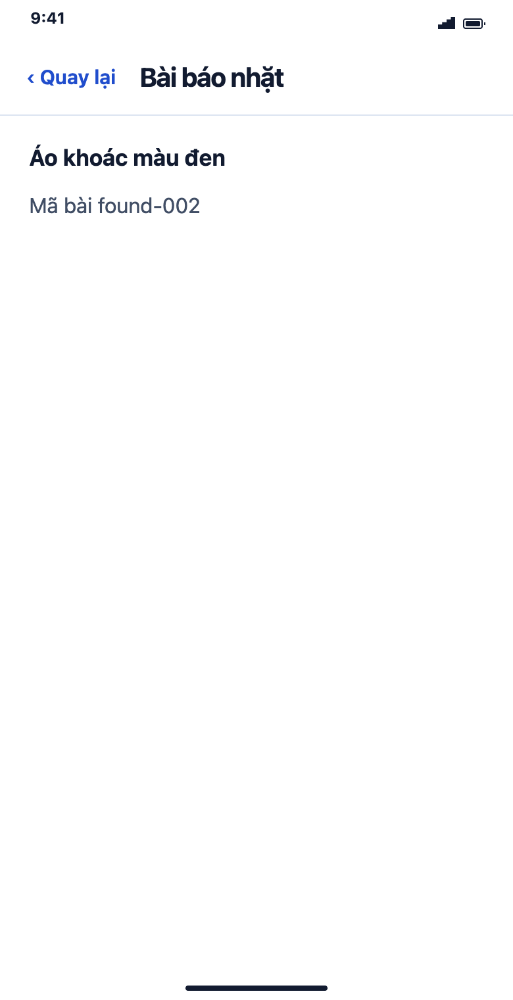

Đích thử nghiệm hiển thị tên và mã bài Found, kể cả khi hàng dùng ảnh thay thế. **Quay lại** về Hồ sơ tại tab đang xem. Quyền và lỗi bài bị gỡ thuộc UC chi tiết. Đối chiếu [luồng thay thế](uc-02-profile-and-my-items.md#giao-dien-alt) và SCN-PRF-13.

### SCR-04 · Xác nhận đăng xuất

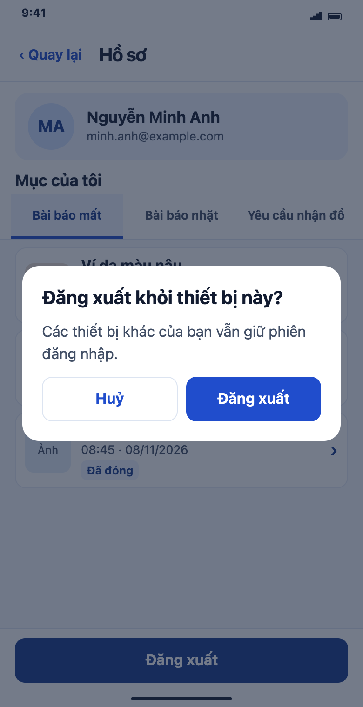

Hộp thoại phủ màn Hồ sơ với phần Mục của tôi. **Huỷ** đóng hộp thoại và giữ tab hiện hành. **Đăng xuất** dọn thiết bị này. Dòng mô tả về thiết bị khác lấy từ mockup và phù hợp GAP-AUTH-004. Đối chiếu [luồng thay thế](uc-02-profile-and-my-items.md#giao-dien-alt) và SCN-AUTH-15–17 và SCN-PRF-15.

### SCR-01 · Đang dọn phiên

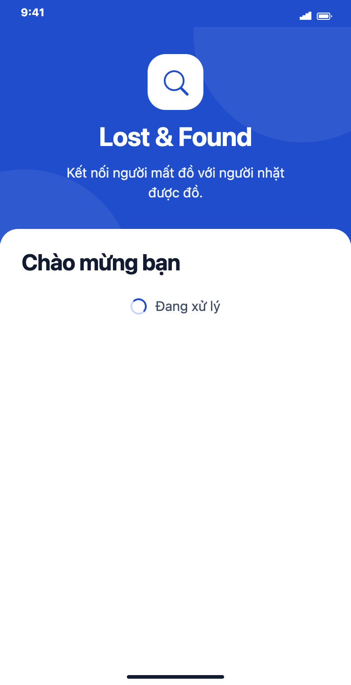

Chỉ báo chờ trong lúc dọn. Vùng cá nhân đã ẩn và Quay lại bị chặn ở trạng thái chờ này. Đối chiếu [luồng thay thế](uc-02-profile-and-my-items.md#giao-dien-alt), [luồng ngoại lệ](uc-02-profile-and-my-items.md#giao-dien-error) và SCN-AUTH-13/16/17/21 và SCN-PRF-15.

### SCR-01 · Yêu cầu đăng nhập lại

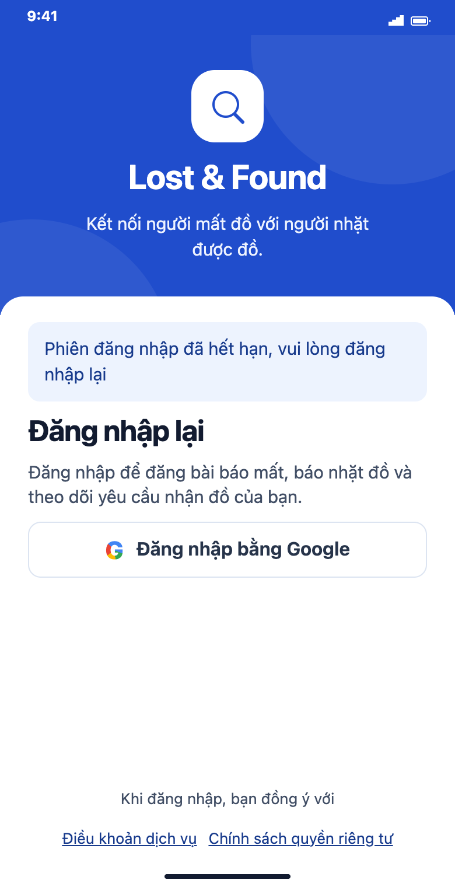

Màn đã dọn hiển thị thông báo hết phiên và lối đăng nhập Google. Mốc FR-AUTH-10 tính từ lúc phát hiện mất phiên. Đối chiếu [luồng ngoại lệ](uc-02-profile-and-my-items.md#giao-dien-error) và SCN-AUTH-13/21 và SCN-PRF-12/15.

### SCR-01 · Đăng xuất cục bộ, chờ xác nhận thu hồi

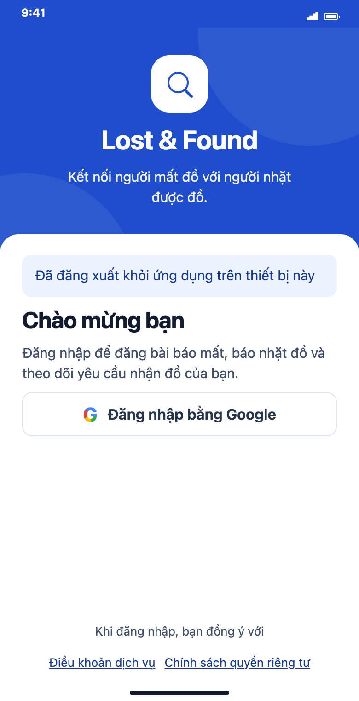

Thông báo xác nhận việc đăng xuất trên thiết bị này. Nếu nhận được xác nhận thu hồi trước khi sang lượt mới, Mobile trở về hình Đăng nhập sạch. Đối chiếu [luồng thay thế](uc-02-profile-and-my-items.md#giao-dien-alt), [luồng ngoại lệ](uc-02-profile-and-my-items.md#giao-dien-error) và SCN-AUTH-17 và SCN-PRF-15.

### SCR-01 · Đăng nhập

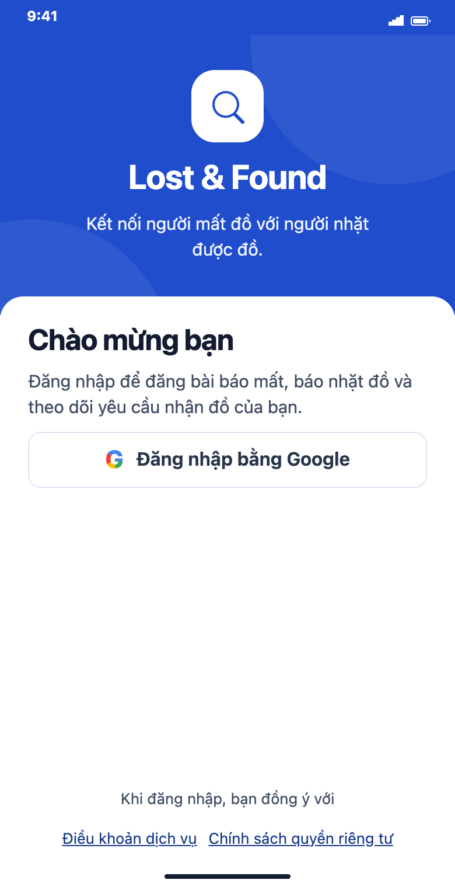

Có nút **Đăng nhập bằng Google** và hai liên kết chính sách. Hình nút minh họa vị trí và trạng thái thao tác. Bản native dùng nút của SDK. Đối chiếu [luồng thay thế](uc-02-profile-and-my-items.md#giao-dien-alt), [luồng ngoại lệ](uc-02-profile-and-my-items.md#giao-dien-error) và SCN-AUTH-01–03/17/19 và SCN-PRF-15.

## Các quyết định còn mở

- **Hiển thị đủ.** Sản phẩm và QA chốt ảnh thay thế có được tính vào mốc đủ nội dung của PR-04/05 ở Hồ sơ và các hàng Lost/Found. Ảnh hưởng bước 2/4, nhánh ảnh thay thế và SCN-PRF-02/05/17.
- **Dữ liệu và đích thật.** Sản phẩm chốt cách xử lý tên/email Google thiếu hoặc tên ngoài khoảng. Các UC sở hữu chốt trạng thái thật, hai vai trò trên cùng yêu cầu, lịch sử khi bài bị gỡ, vòng đời ảnh và quyền/lỗi ở đích. Bộ hình dùng dữ liệu mẫu và đích thử nghiệm. Ảnh hưởng bước 2/4, nhánh ảnh thay thế, đổi tab, mở bài và SCN-PRF-01/02/04–06/13.
- **Sai tab ở Mobile.** SCN-PRF-09 kiểm hợp đồng khi tham số tab thiếu hoặc sai. Ba tab trong app tạo giá trị hợp lệ. Xác nhận có cần thông báo riêng nếu lỗi này đến Mobile ngoài thao tác chọn tab thông thường. App hiện dùng mẫu lỗi máy chủ.
- Các điểm về phạm vi hoãn và đo tải ở [phần còn mở của UC spec](uc-02-profile-and-my-items.md#khác-biệt-giữa-nguồn-và-tiêu-chí-còn-mở).
