# UC-02 · Giao diện đăng nhập

**UI 0.1 · Chờ duyệt**

Giao diện theo [hướng dẫn Lost & Found 0.2 · Chờ duyệt](../design/ui-guidelines.md), [đặc tả UC02 0.2](uc-02.md) và [hợp đồng REST v1](../api/core/v1-notes.md#uc02-login). Chưa tìm thấy SCR ID cho các màn và điểm đích trong phạm vi này. Các biến thể đăng nhập dùng chung màn cha, mỗi trạng thái có neo ASCII ổn định.

Bộ hình gồm 16 khung SVG chỉnh sửa được dựng tại repo và một hình từ UC01. Các khung tĩnh 390 × 760 dùng dữ liệu mẫu, phong cách đăng nhập và màu của hướng dẫn nhóm. Cần kiểm cách cuộn khi bàn phím mở, cỡ chữ động, trình đọc màn hình và điều hướng thực tế trên thiết bị sau khi có bản chạy.

## Kịch bản UX

- **Đăng nhập trực tiếp hoặc từ UC01.** [Đăng nhập](#dang-nhap) → [đang gửi](#dang-nhap-dang-gui) → [bảng tin](#vao-bang-tin) hoặc [điểm vào Admin](#vao-quan-tri) khi nhận phiên. Với 400, 401, 403, 429 và 503 hoặc mất kết nối, dùng các trạng thái tương ứng bên dưới. Thông báo form áp dụng cho lần gửi còn hiện hành.
- **Từ UC13.** [Chi tiết công khai](#chi-tiet-can-dang-nhap) → [đăng nhập có ngữ cảnh bài](#dang-nhap-tu-bai) → [tải lại bài](#tai-lai-bai) → tiếp tục [Found](#tiep-tuc-found) hoặc [Lost](#tiep-tuc-lost), hay dừng với [thao tác bị từ chối](#thao-tac-bi-tu-choi), [bài không còn khả dụng](#bai-khong-kha-dung) hoặc [tải lại lỗi](#bai-thu-tai-lai). UI dùng loại và trạng thái bài hiện hành để điều hướng. Quyền với thao tác được Core kiểm ở endpoint đích.
- **Từ chối chung và quay lại UC01.** [403](#dang-nhap-bi-tu-choi) → nếu người dùng chọn gửi lại, mở [gửi lại email xác thực](uc-01-ui.md#gui-lai-email). UC01 sở hữu đường mở hộp thư, xác thực và [điểm quay lại đăng nhập](uc-01-ui.md#xac-thuc-thanh-cong).
- **Cần duyệt.** Nhóm sản phẩm và Mobile duyệt tên/điểm đến, trạng thái quay lại UC13 qua UC01 và cách trình bày nút thử lại sau khi Admin mở khóa sớm. Các quyết định này liên quan SCN-UC02-01, 04, 05 và 06. Với lỗi tải chi tiết, chỉ tải lại bài. Với yêu cầu ghi, biểu mẫu đích giữ bước xác nhận của người dùng.

## Minh họa

### Màn đăng nhập

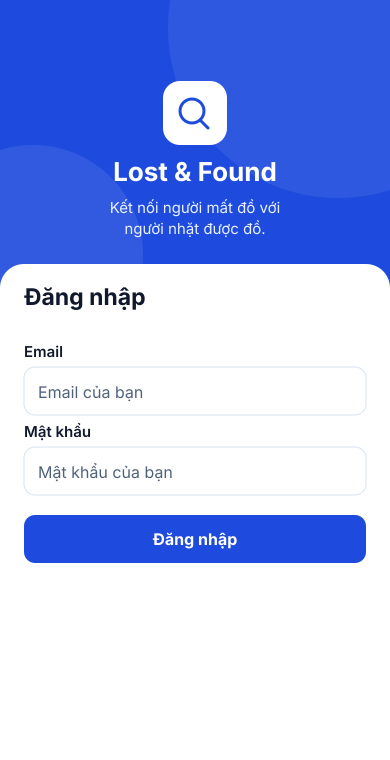

**SCR ID chưa được cấp.** Điểm vào trực tiếp hoặc từ UC01. Nhập email, mật khẩu rồi chọn Đăng nhập. [Về đặc tả](uc-02.md#main-flow). [SCN-UC02-01](uc-02.md#scn-uc02-01) · [SCN-UC02-02](uc-02.md#scn-uc02-02).

### Đăng nhập từ chi tiết bài

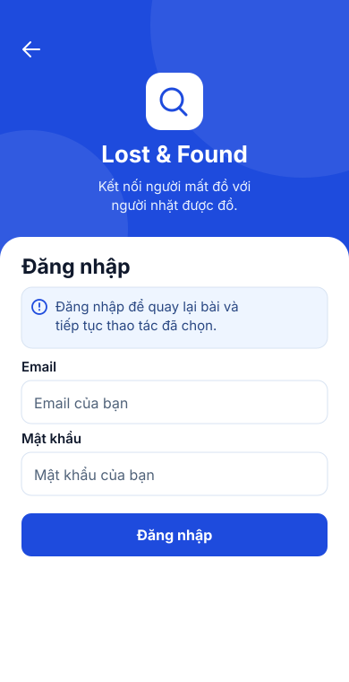

**SCR ID chưa được cấp.** Form giữ ngữ cảnh quay lại bài và thao tác đã chọn. Quay lại bằng điều hướng của ứng dụng nếu muốn hủy. [Về đặc tả](uc-02.md#a1-tu-chi-tiet-bai). [SCN-UC02-05](uc-02.md#scn-uc02-05).

### Đang đăng nhập

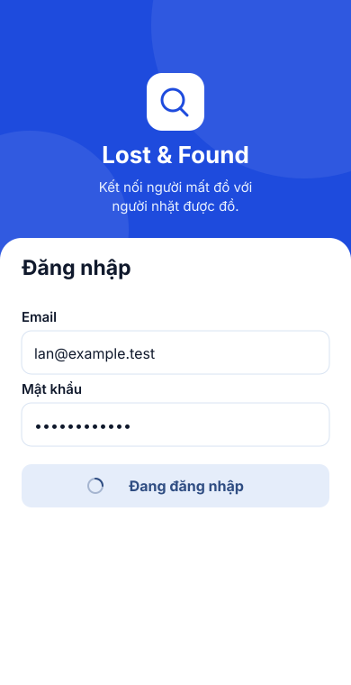

**SCR ID chưa được cấp.** Hiện chỉ báo gần nút và chặn gửi lặp. Kết quả hợp lệ của lần gửi hiện hành quyết định trạng thái tiếp theo. [Về đặc tả](uc-02.md#main-flow). [SCN-UC02-01](uc-02.md#scn-uc02-01) · [SCN-UC02-08](uc-02.md#scn-uc02-08).

### Dữ liệu đăng nhập cần sửa

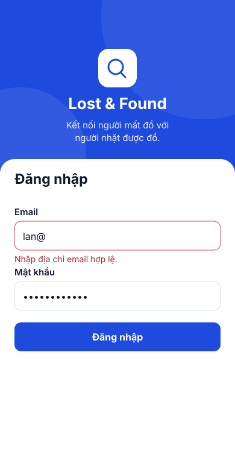

**SCR ID chưa được cấp.** Ví dụ lỗi email có thể xác định tại trường. Với 400 chung, đặt lỗi gần nút gửi và giữ form để sửa. [Về đặc tả](uc-02.md#exception-flows). [SCN-UC02-08](uc-02.md#scn-uc02-08).

### Thông tin đăng nhập không đúng

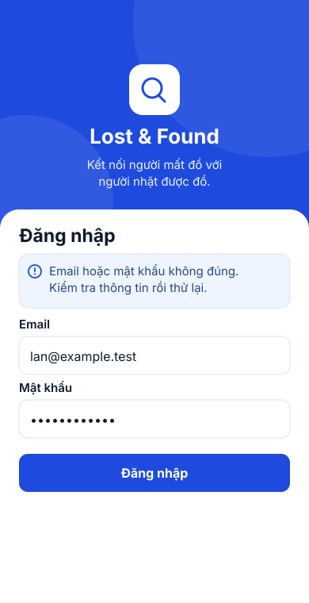

**SCR ID chưa được cấp.** 401 dùng cùng một nội dung khi email không khớp hoặc mật khẩu sai. Khách có thể sửa và gửi lại. [Về đặc tả](uc-02.md#exception-flows). [SCN-UC02-02](uc-02.md#scn-uc02-02) · [SCN-UC02-03](uc-02.md#scn-uc02-03).

### Đăng nhập tạm thời bị khóa

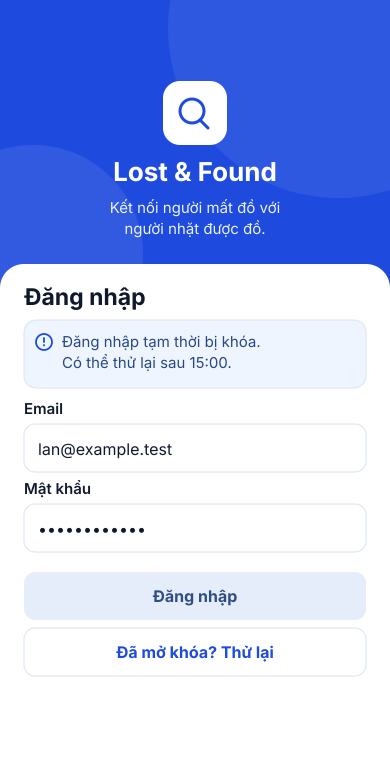

**SCR ID chưa được cấp.** 429 hiển thị thời gian còn lại theo Retry-After, ngay ở lượt chạm ngưỡng. Hết thời gian thì mở nút Đăng nhập cho email tương ứng. Đề xuất nút “Đã mở khóa? Thử lại” để người dùng chủ động kiểm lại sau khi Admin mở khóa sớm. Nếu còn khóa, Core trả 429 với thời gian còn lại. [Về đặc tả](uc-02.md#exception-flows). [SCN-UC02-03](uc-02.md#scn-uc02-03) · [SCN-UC02-04](uc-02.md#scn-uc02-04) · [SCN-UC02-07](uc-02.md#scn-uc02-07).

### Đăng nhập bị từ chối

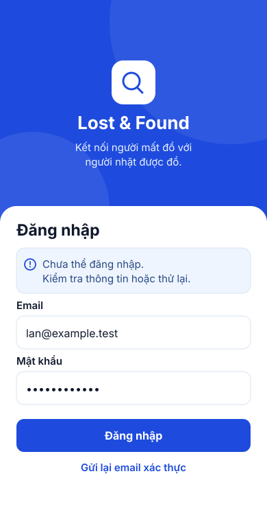

**SCR ID chưa được cấp.** 403 dùng nội dung chung. Link Gửi lại email xác thực mở màn UC01. Hình dùng lại từ UC01 vì hành vi bàn giao trùng nhau. [Về đặc tả](uc-02.md#a2-gui-lai-xac-thuc). [SCN-UC02-04](uc-02.md#scn-uc02-04) · [SCN-UC02-06](uc-02.md#scn-uc02-06).

### Chưa nhận được kết quả đăng nhập

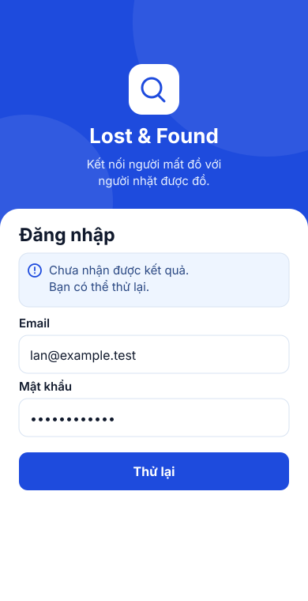

**SCR ID chưa được cấp.** 503 hoặc mất mạng giữ ngữ cảnh form và cho người dùng bấm Thử lại. Chỉ chuyển màn khi nhận được phiên. [Về đặc tả](uc-02.md#exception-flows). [SCN-UC02-08](uc-02.md#scn-uc02-08).

### Điểm vào của thành viên

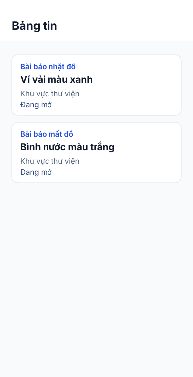

**SCR ID chưa được cấp.** Ví dụ điểm đến khi đăng nhập trực tiếp với vai trò member. Chi tiết bảng tin thuộc UC11. [Về đặc tả](uc-02.md#main-flow). [SCN-UC02-01](uc-02.md#scn-uc02-01).

### Điểm vào của Admin

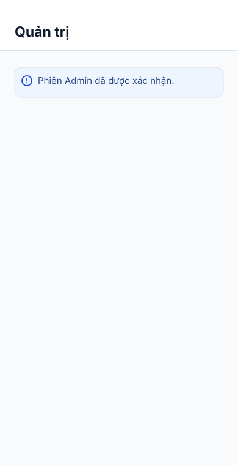

**SCR ID chưa được cấp.** Ví dụ điểm đến khi đăng nhập trực tiếp với vai trò admin. Các thao tác quản trị được Core kiểm theo quyền tương ứng. [Về đặc tả](uc-02.md#main-flow). [SCN-UC02-01](uc-02.md#scn-uc02-01).

### Chi tiết bài, điểm vào từ UC13

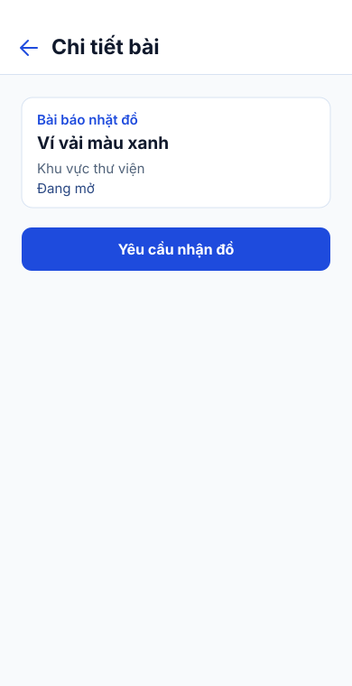

**SCR ID chưa được cấp.** Bài Found công khai làm ví dụ. Khách bấm Yêu cầu nhận đồ để mở đăng nhập. Bài Lost có điểm vào tương ứng khi chọn gửi phản hồi. [Về đặc tả](uc-02.md#a1-tu-chi-tiet-bai). [SCN-UC02-05](uc-02.md#scn-uc02-05).

### Đang tải lại chi tiết bài

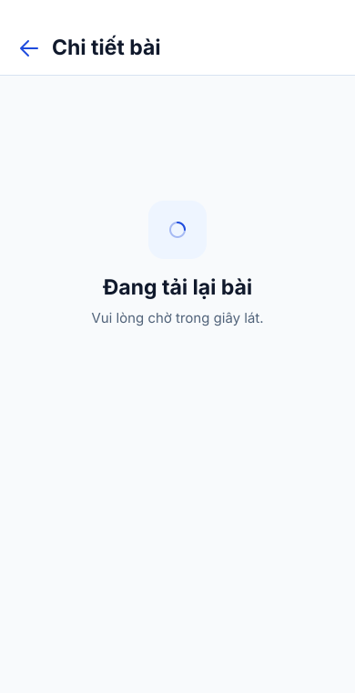

**SCR ID chưa được cấp.** Sau 200 từ đăng nhập, Mobile tải lại bài theo ID. 200 từ chi tiết → xét thao tác đã chọn. 404 → bài không còn khả dụng. 503 hoặc lỗi kết nối → thử tải lại. [Về đặc tả](uc-02.md#a1-tu-chi-tiet-bai). [SCN-UC02-05](uc-02.md#scn-uc02-05) · [SCN-UC02-08](uc-02.md#scn-uc02-08).

### Quay lại bài Found

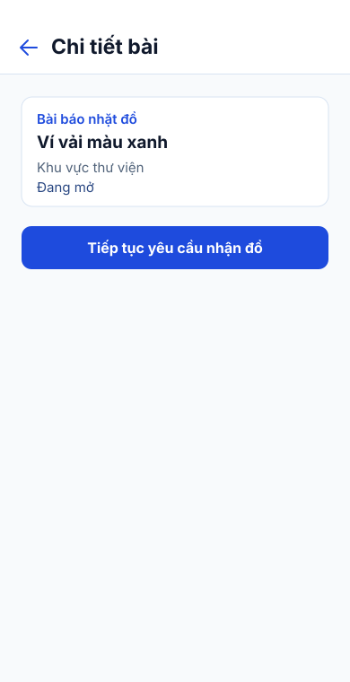

**SCR ID chưa được cấp.** Tiếp tục yêu cầu nhận đồ dẫn đến UC15. Core kiểm quyền khi đọc câu hỏi và khi gửi yêu cầu. [Về đặc tả](uc-02.md#a1-tu-chi-tiet-bai). [SCN-UC02-05](uc-02.md#scn-uc02-05).

### Quay lại bài Lost

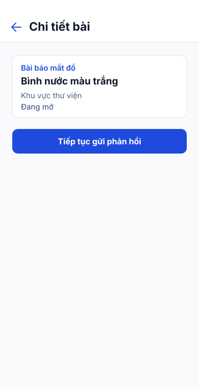

**SCR ID chưa được cấp.** Tiếp tục gửi phản hồi dẫn đến UC17. Core kiểm quyền tại endpoint đích khi người dùng gửi biểu mẫu. [Về đặc tả](uc-02.md#a1-tu-chi-tiet-bai). [SCN-UC02-05](uc-02.md#scn-uc02-05).

### Thao tác không còn khả dụng

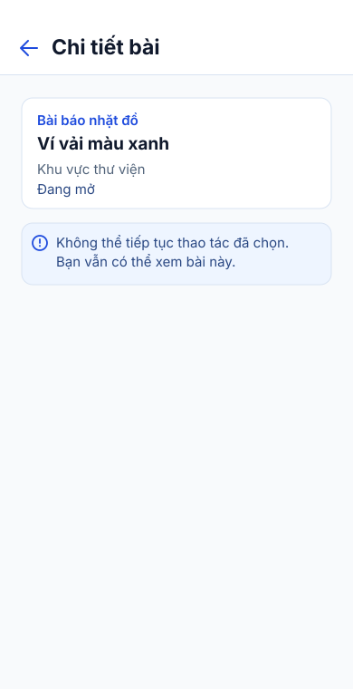

**SCR ID chưa được cấp.** Nếu bài vẫn công khai nhưng loại bài hoặc kết quả kiểm quyền không cho phép tiếp tục thao tác, giữ chi tiết công khai và báo không thể thực hiện thao tác đang chọn. [Về đặc tả](uc-02.md#exception-flows). [SCN-UC02-05](uc-02.md#scn-uc02-05).

### Bài không còn khả dụng

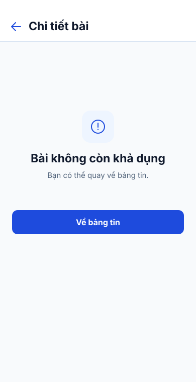

**SCR ID chưa được cấp.** Dùng cùng thông báo cho 404 của bài đã đóng, bị ẩn hoặc không tồn tại. Người dùng có thể quay về bảng tin với phiên vừa nhận. [Về đặc tả](uc-02.md#exception-flows). [SCN-UC02-05](uc-02.md#scn-uc02-05).

### Thử tải lại chi tiết bài

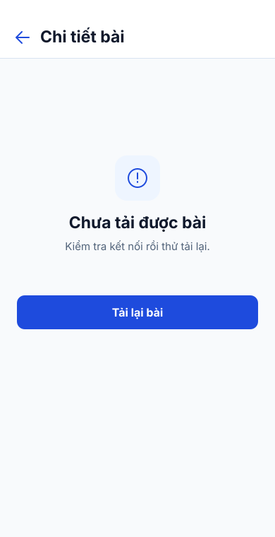

**SCR ID chưa được cấp.** Khi tải chi tiết gặp 503 hoặc mất kết nối, nút Tải lại bài thực hiện lại yêu cầu chi tiết bằng ngữ cảnh hiện hành. Phiên đăng nhập vẫn dùng được nếu còn hiệu lực. [Về đặc tả](uc-02.md#exception-flows). [SCN-UC02-08](uc-02.md#scn-uc02-08).
